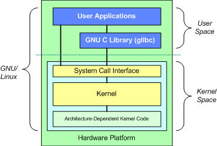
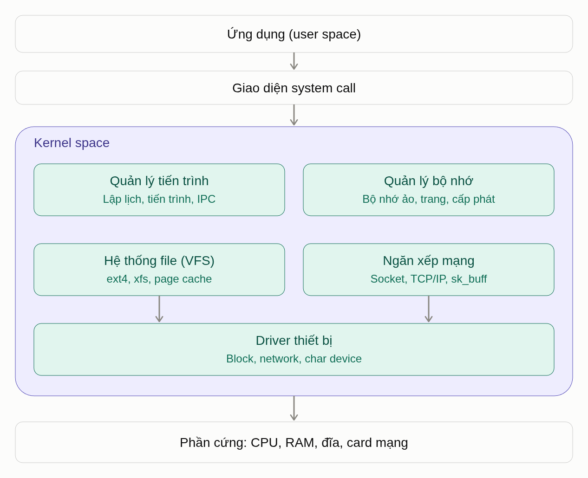
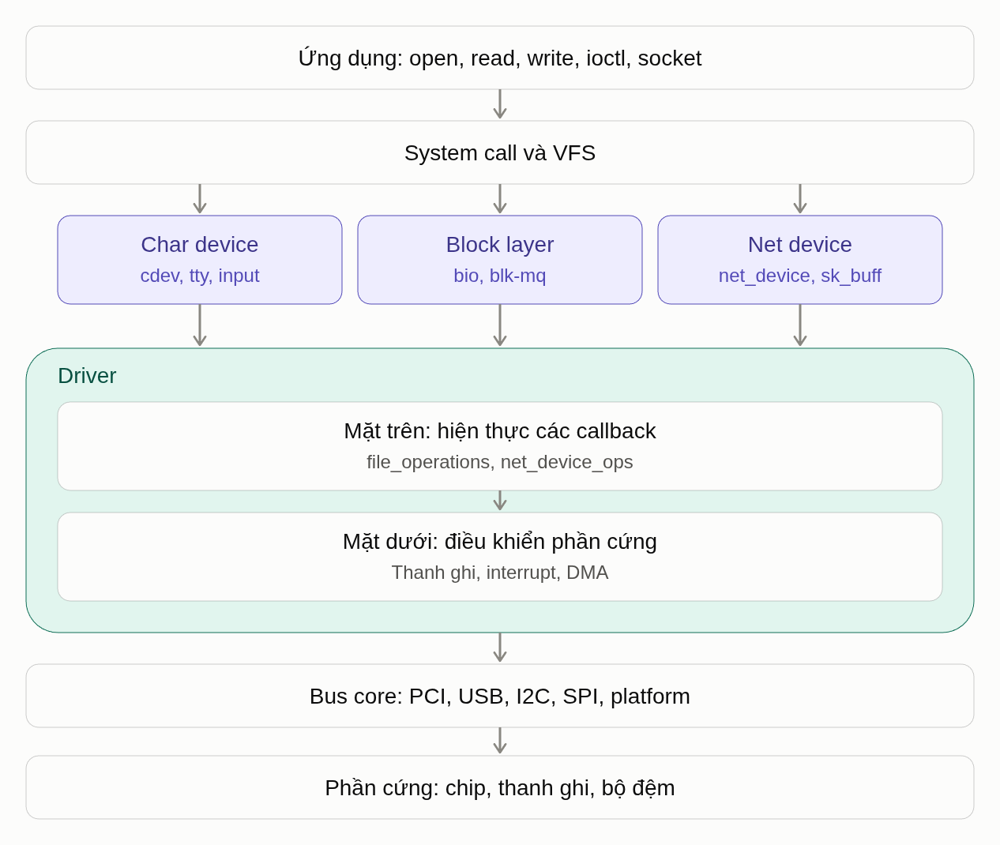
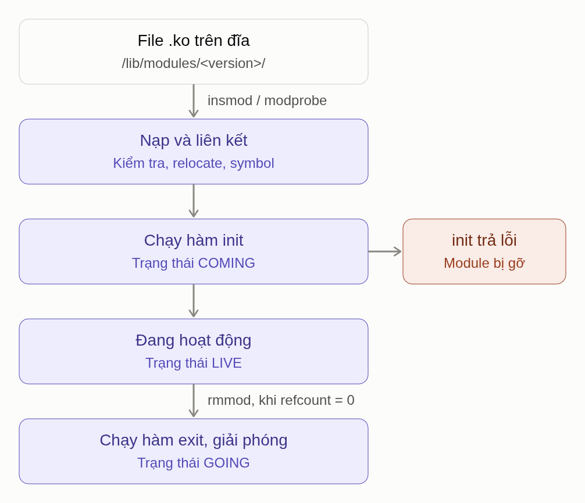

# Linux OS Overview & Kernel Module/Driver Basics

<!-- git remote add origin https://github.com/trungnm2111/Session-8-Lab.git -->

## 1. Hệ điều hành là gì?

Về bản chất, **hệ điều hành** (Operating System – OS) là một phần mềm đặc biệt nằm giữa phần cứng và các chương trình/người dùng. Nó quản lý toàn bộ tài nguyên của máy tính (CPU, RAM, ổ đĩa, thiết bị ngoại vi) và cung cấp môi trường để các chương trình khác chạy được.

Ứng dụng không "nói chuyện" trực tiếp với phần cứng. Mọi yêu cầu như đọc file, hiển thị lên màn hình hay gửi dữ liệu qua mạng đều phải đi qua hệ điều hành.

***Tại sao cần hệ điều hành?***

Nếu không có hệ điều hành, mỗi lập trình viên sẽ phải tự viết code điều khiển trực tiếp từng linh kiện phần cứng, và mọi thứ sẽ rất hỗn loạn. Hệ điều hành giải quyết bốn vấn đề cốt lõi:

1. **Trừu tượng hóa phần cứng** (che giấu sự phức tạp)
   Phần cứng rất phức tạp và đa dạng: mỗi hãng ổ cứng, card mạng lại có cách điều khiển khác nhau. Hệ điều hành che giấu các chi tiết đó và đưa ra những khái niệm đơn giản như *file*, *thư mục*, *cửa sổ*. Lập trình viên chỉ cần gọi lệnh "mở file", không cần biết dữ liệu nằm ở sector nào trên đĩa.

2. **Quản lý và phân chia tài nguyên**
   Bạn có thể vừa nghe nhạc, vừa lướt web, vừa tải file, trong khi CPU tại mỗi thời điểm chỉ xử lý được một số lượng lệnh giới hạn. Hệ điều hành chia thời gian CPU thành các lát rất nhỏ và luân phiên cho từng chương trình chạy, nhanh đến mức ta cảm giác chúng chạy đồng thời. Tương tự, nó cấp phát RAM, phân chia dung lượng đĩa và điều phối quyền dùng máy in, mạng…

3. **Bảo vệ và cách ly**
   Hệ điều hành đảm bảo chương trình này không thể đọc trộm hay phá hỏng bộ nhớ của chương trình khác, và một ứng dụng bị lỗi không kéo sập cả máy. Nó cũng kiểm soát quyền truy cập: người dùng nào được xem file nào.

4. **Cung cấp giao diện cho người dùng**
   Thông qua giao diện đồ họa (GUI) hoặc dòng lệnh (CLI), hệ điều hành cho phép con người tương tác với máy tính một cách thuận tiện.

---

## 2. Linux và các thành phần chính

Linux ban đầu chỉ là tên của một **kernel** (nhân hệ điều hành), do Linus Torvalds viết năm 1991 khi còn là sinh viên ở Phần Lan. Người ta ghép kernel Linux với rất nhiều phần mềm khác (đặc biệt là các công cụ của dự án GNU) để tạo thành một hệ điều hành hoàn chỉnh.

***Ba đặc điểm bản chất của Linux***
- **Mã nguồn mở** — Mã nguồn được phát hành theo giấy phép GPL, ai cũng có thể xem, sửa đổi và phân phối lại. Đây là lý do có hàng trăm phiên bản Linux khác nhau.
- **Thuộc họ Unix-like** — Linux được thiết kế theo triết lý và cách tổ chức của Unix (ra đời từ thập niên 1970), nhưng được viết lại hoàn toàn, không dùng mã của Unix.
- **Đa người dùng, đa nhiệm** — Ngay từ thiết kế, nhiều người có thể dùng chung một máy, mỗi người có quyền hạn riêng, và nhiều chương trình chạy đồng thời.

***Distribution (bản phân phối) là gì?***

Vì kernel và các phần mềm đi kèm đều tự do, các tổ chức khác nhau đóng gói chúng theo cách riêng, kèm trình quản lý phần mềm, cấu hình mặc định và giao diện riêng. Mỗi gói như vậy gọi là một **distro**, ví dụ Ubuntu, Debian, Fedora, Red Hat Enterprise Linux, Arch Linux. Tất cả đều dùng chung kernel Linux, chỉ khác nhau ở "lớp vỏ" bên ngoài.

**Các thành phần chính**


Hệ thống Linux được tổ chức thành các lớp lồng nhau, từ trong ra ngoài: **Hardware → Kernel → Shell → Applications & Utilities**. Mỗi lớp chỉ giao tiếp với lớp liền kề; người dùng ở ngoài cùng không bao giờ chạm trực tiếp vào phần cứng.

*1. Hardware (phần cứng)*

Lớp trong cùng, gồm các thiết bị vật lý: CPU, RAM, ổ đĩa, card mạng, bàn phím, màn hình và các thiết bị ngoại vi khác. Phần cứng chỉ hiểu các tín hiệu và thanh ghi cấp thấp, không biết gì về file, tiến trình hay người dùng. Chỉ kernel mới được truy cập trực tiếp vào lớp này.

*2. Kernel (nhân)*

Trái tim của hệ thống, chạy ở chế độ đặc quyền cao nhất (kernel space) và là phần duy nhất được chạm trực tiếp vào phần cứng. Kernel đảm nhận:

- Quản lý tiến trình và lập lịch CPU
- Quản lý bộ nhớ
- Quản lý hệ thống file
- Điều khiển thiết bị qua driver
- Xử lý mạng
- Cung cấp các dịch vụ thiết yếu cho các thành phần phần mềm ở cấp cao hơn thông qua **system call** (ví dụ `read()`, `write()`, `fork()`)

Kernel Linux thuộc loại **monolithic** (nguyên khối): hầu hết chức năng nằm chung trong một khối chạy ở kernel space, giúp tốc độ cao. Nó vẫn linh hoạt nhờ **kernel module**: driver có thể được nạp hoặc gỡ khi đang chạy mà không cần khởi động lại.

*3. Shell (trình thông dịch lệnh)*

Lớp trung gian giữa người dùng và kernel. Shell nhận lệnh bạn gõ, dịch chúng và yêu cầu kernel thực thi (thông qua system call). Phổ biến nhất là **Bash**, ngoài ra có Zsh, Fish.

Shell là sức mạnh lớn của Linux: bạn có thể kết hợp các lệnh nhỏ thành chuỗi xử lý phức tạp qua pipe `|`, hoặc viết **shell script** để tự động hóa công việc.

*4. Applications (ứng dụng)*

Lớp ngoài cùng, gồm các chương trình người dùng sử dụng hằng ngày: trình duyệt web, trình soạn thảo, IDE, trình phát nhạc, máy chủ web, cơ sở dữ liệu… Ứng dụng chạy trong **user space** và không truy cập phần cứng trực tiếp; mọi yêu cầu (đọc file, gửi dữ liệu qua mạng, hiển thị lên màn hình) đều phải đi qua kernel, thường thông qua các thư viện hệ thống như **glibc**.

*5. Utilities (tiện ích hệ thống)*

Cùng lớp với Applications, là bộ công cụ dòng lệnh cơ bản để làm việc với hệ thống: `ls`, `cp`, `mv`, `grep`, `cat`, `chmod`, `ps`, `top`… Phần lớn đến từ dự án GNU. Mỗi công cụ làm tốt một việc nhỏ, theo triết lý Unix, và được kết hợp với nhau thông qua shell.

**Các thành phần khác**

- **Bootloader** — chương trình chạy đầu tiên khi bật máy, nạp kernel vào bộ nhớ và trao quyền điều khiển cho nó. Phổ biến nhất là **GRUB**, cho phép chọn hệ điều hành nếu máy cài song song Windows và Linux.
- **System call** — "cánh cửa" duy nhất giữa user space và kernel. Kernel kiểm tra quyền rồi mới thực hiện thay cho ứng dụng.
- **Thư viện hệ thống** — như **glibc**, đóng gói system call thành các hàm dễ dùng. Ví dụ `printf()` gọi system call `write()` bên dưới.
- **Init system** — tiến trình đầu tiên (**PID 1**) do kernel chạy sau khi khởi động, có nhiệm vụ khởi động và quản lý mọi dịch vụ khác. Hầu hết distro hiện nay dùng **systemd**.
- **Daemon** — chương trình chạy ngầm, chờ phục vụ yêu cầu, ví dụ `sshd`, `cron`, `httpd`. Tên thường kết thúc bằng chữ "d".
- **Giao diện đồ họa** — chỉ là một ứng dụng bình thường, **không bắt buộc**. Rất nhiều máy chủ Linux chạy hoàn toàn không có giao diện đồ họa.

**Hệ thống file**

Linux tổ chức mọi thứ thành **một cây thư mục duy nhất** bắt đầu từ gốc `/`, không chia ổ `C:`, `D:` như Windows.

Các thư mục con quan trọng trong `/`:

| Thư mục | Nội dung |
|---|---|
| `/etc` | Các tệp cấu hình của hệ thống |
| `/bin`, `/sbin` | Các lệnh và tệp thực thi cơ bản cho người dùng và quản trị viên |
| `/dev` | Các file đại diện cho phần cứng và thiết bị ngoại vi |
| `/lib` | Thư viện chia sẻ (shared libraries) và kernel module |
| `/boot` | File kernel và các file của bootloader |
| `/home` | Thư mục cá nhân của người dùng thông thường |
| `/root` | Thư mục cá nhân của tài khoản root — **khác** với thư mục gốc `/` |
| `/var` | Dữ liệu thay đổi liên tục như log, cache |
| `/tmp` | Tệp tạm thời, thường bị xóa khi khởi động lại |

***Hai triết lý cốt lõi***

> **"Mọi thứ đều là file."**
> Trong Linux, không chỉ tài liệu mà cả thiết bị phần cứng (`/dev/sda` là ổ cứng), thông tin tiến trình (`/proc`) hay kết nối mạng đều được biểu diễn như file. Nhờ vậy, cùng một bộ công cụ đọc/ghi file có thể dùng cho rất nhiều thứ.

> **"Làm một việc và làm thật tốt."**
> Thay vì một chương trình khổng lồ làm mọi việc, Linux có nhiều công cụ nhỏ, kết hợp với nhau qua pipe `|`. Ví dụ, lệnh sau đếm số dòng lỗi trong file log bằng cách nối ba công cụ đơn giản:
>
> ```bash
> cat log.txt | grep error | wc -l
> ```

---

## 3. User space và Kernel space

### 3.1. Khái niệm

- **Kernel space** The Kernel Space, also referred to as the System Space, is a privileged domain dedicated to the execution of kernel programs. It includes all the memory and facilitates interaction with hardware components such as RAM and hard disks. Within the Kernel Space, different blocks and modules handle various operations essential to the operating system, including file management, memory management, and process management. The Kernel Space includes components such as the system call interface, the kernel itself (the core component of Linux), and device modules.
- **User space** The User Space is the domain where user applications and processes operate. It is the area where most user-level programs, such as software applications and utilities, execute. User Space does not have direct access to memory or hardware. It connects to the hardware via kernel space. User-space processes or programs can only access some parts of memory via system calls. Crashes in user mode are recoverable due to complete protection. The GNU C library in the user space provides the mechanism for switching user space applications to the kernel space.

Mục đích của sự phân chia là **cô lập và bảo vệ**: một chương trình lỗi hay độc hại không thể phá hệ thống hoặc đọc dữ liệu của tiến trình khác.


### 3.2. Cơ chế phần cứng

Ranh giới do **CPU** và **MMU** thực thi, phần mềm không thể tự "lách" qua được. Có ba cơ chế chính.

**① Mức đặc quyền của CPU**

Trên x86 có các "ring": kernel chạy ở **Ring 0**, ứng dụng chạy ở **Ring 3**. Trên ARM tương ứng là **EL1** và **EL0**. Một số lệnh là lệnh đặc quyền, ví dụ tắt ngắt (`cli`), đổi bảng trang (`mov cr3`) hay truy cập cổng I/O. Nếu ứng dụng chạy chúng ở Ring 3, CPU sinh ngoại lệ và kernel thường giết tiến trình đó.


**② Bit U/S trong bảng trang**

Mỗi trang nhớ có một bit đánh dấu nó thuộc **User** hay **Supervisor**. Khi CPU đang ở user mode mà truy cập trang Supervisor, MMU chặn lại và gây **page fault**. Trên Linux, bạn thấy kết quả này dưới dạng lỗi `Segmentation fault`.

**③ Các cổng chuyển đổi hợp lệ**

Cách duy nhất để từ user mode vào kernel mode là đi qua các "cửa" do kernel định sẵn: lệnh `syscall`, ngắt phần cứng, hoặc ngoại lệ như page fault hay chia cho 0. Ứng dụng không thể nhảy vào một địa chỉ tùy ý trong kernel.


### 3.3. Bộ nhớ: không gian địa chỉ

***Phân chia không gian địa chỉ ảo***

Mỗi tiến trình có **user space riêng**: cùng một địa chỉ ảo như `0x400000` ở hai tiến trình khác nhau trỏ tới hai trang vật lý khác nhau. Ngược lại, phần **kernel space được ánh xạ giống nhau vào mọi tiến trình**. Nhờ vậy, khi có system call, CPU không cần đổi bảng trang, chỉ cần đổi chế độ là có thể chạy mã kernel.


***Cơ chế bảo vệ***

Mỗi mục trong bảng trang có bit U/S (User/Supervisor). Trang của kernel được đánh dấu "chỉ Supervisor"; code user mode truy cập vào sẽ gây page fault.

Các cơ chế tăng cường thêm:

| Cơ chế | Tác dụng |
|---|---|
| **SMEP** | Kernel không được *thực thi* code nằm ở trang user |
| **SMAP** | Kernel không được *đọc/ghi* trang user, trừ khi chủ động cho phép |
| **KPTI** | Ra đời sau lỗ hổng Meltdown: khi chạy ở user mode, hầu hết vùng kernel bị gỡ khỏi bảng trang |

Vì vậy kernel không thể tùy tiện tin con trỏ do user đưa vào. Nó phải dùng các hàm như `copy_from_user()` / `copy_to_user()` để kiểm tra và sao chép dữ liệu qua ranh giới.

### 3.4. Khác biệt về tiến trình và thực thi

Một tiến trình thường di chuyển qua lại giữa hai chế độ. Bình thường nó chạy ở user mode. Khi gọi system call, chính tiến trình đó chuyển sang kernel mode để kernel làm việc "thay mặt" nó, rồi quay lại.

**Ba con đường vào kernel space:**

| Con đường | Mô tả | Ví dụ |
|---|---|---|
| **System call** | Chủ động gọi, qua lệnh `syscall` (x86-64) hoặc `svc` (ARM) | `read`, `write`, `fork`, `mmap` |
| **Exception** | Lỗi đồng bộ do chính lệnh đang chạy gây ra | Page fault, chia cho 0 |
| **Interrupt** | Sự kiện bất đồng bộ từ phần cứng | Timer, card mạng, bàn phím |

**Kernel thread** là loại thực thể chỉ sống trong kernel space, ví dụ `kworker`, `ksoftirqd`, `kswapd`. Chúng không có phần user space (trường `mm` bằng `NULL`) và không bao giờ về user mode.

***Mode switch ≠ Context switch***

Đây là điểm hay bị nhầm:

| | Mode switch | Context switch |
|---|---|---|
| **Là gì** | Cùng một tiến trình, chỉ đổi user mode ↔ kernel mode | Đổi sang tiến trình khác |
| **Chi phí** | Tương đối rẻ (cỡ trăm nanosecond), dù KPTI làm nó đắt hơn | Đắt hơn nhiều: lưu/khôi phục thanh ghi, đổi bảng trang, cache/TLB bị ảnh hưởng |

> Một syscall gây ra **2 lần mode switch**, nhưng không nhất thiết gây context switch.

---

## 4. Tổng quan các thành phần của Linux Kernel

Kernel Linux là **monolithic** nhưng được tổ chức theo hướng **mô-đun**: mã nguồn chia thành nhiều subsystem, mỗi subsystem chịu trách nhiệm quản lý một loại tài nguyên và phối hợp với nhau để phục vụ các tiến trình ở user space. Các subsystem cốt lõi gồm:

- **Process Scheduler** — bộ lập lịch tiến trình
- **Memory Management** — quản lý bộ nhớ
- **Virtual File System (VFS)** — hệ thống file ảo
- **Networking Subsystem** — ngăn xếp mạng
- **Inter-Process Communication (IPC)** — giao tiếp liên tiến trình
- **Device Drivers** — driver thiết bị (thường được tính là subsystem thứ sáu)


> **Lưu ý về thuật ngữ:** trong hình, khối quản lý bộ nhớ được gọi là "Memory Management Unit (MMU)". Thực ra **MMU là một khối phần cứng** nằm trong CPU, có nhiệm vụ dịch địa chỉ ảo sang địa chỉ vật lý. Thứ nằm trong kernel là **subsystem quản lý bộ nhớ** (thư mục `mm/`): nó tạo và cập nhật bảng trang để MMU sử dụng. Tương tự, IPC trong mã nguồn thực tế gắn chặt với quản lý tiến trình, nên nhiều tài liệu gộp hai phần này làm một.

### 4.1. Nguyên lý chung

Mỗi subsystem đều làm cùng một việc theo ba bước:

1. **Quản lý một tài nguyên thật** có giới hạn (CPU, RAM, đĩa, card mạng…).
2. **Chia sẻ** tài nguyên đó an toàn giữa nhiều tiến trình.
3. **Tạo ra một "ảo tưởng"** (abstraction) đơn giản hơn tài nguyên thật để chương trình sử dụng.

| Subsystem | Tài nguyên thật | Ảo tưởng cho chương trình | Cấu trúc dữ liệu cốt lõi | Giao diện với user space | Mã nguồn |
|---|---|---|---|---|---|
| Quản lý tiến trình | CPU | "Tôi có CPU riêng" | `task_struct`, run queue | `fork`, `exec`, `exit`, `wait`, `kill` | `kernel/` |
| Quản lý bộ nhớ | RAM | "Tôi có vùng nhớ lớn, liền mạch, của riêng tôi" | `mm_struct`, `vm_area_struct`, `struct page` | `mmap`, `brk`, `munmap` | `mm/` |
| VFS | Thiết bị lưu trữ | "Mọi thứ là một dòng byte có tên" | `superblock`, `inode`, `dentry`, `file` | `open`, `read`, `write`, `close` | `fs/` |
| Mạng | Card mạng | "Tôi có kênh tin cậy tới máy khác" | `socket`, `sock`, `sk_buff`, `net_device` | `socket`, `bind`, `send`, `recv` | `net/` |
| IPC | Bộ nhớ, đồng bộ | "Các tiến trình có thể nói chuyện với nhau" | `pipe_inode_info`, `futex`, `shmid_kernel` | `pipe`, `shmget`, `futex`, `kill` | `ipc/`, `kernel/` |
| Driver | Thiết bị phần cứng | "Thiết bị là một file / một interface" | `device`, `device_driver`, `file_operations` | `/dev`, `ioctl` | `drivers/` |

Ngoài ra còn có các thành phần dùng chung cho mọi subsystem: **giao diện system call**, **xử lý ngắt** (interrupt, softirq), **cơ chế đồng bộ** (spinlock, mutex, RCU) và phần phụ thuộc kiến trúc CPU (`arch/`).

### 4.2. Quản lý tiến trình và bộ lập lịch (Process Scheduler)

***Tiến trình và luồng trong kernel***

Kernel không phân biệt tiến trình (process) và luồng (thread): cả hai đều là một **task**, được mô tả bằng một `task_struct`. Sự khác nhau chỉ nằm ở chỗ task đó **chia sẻ** những gì với task khác. Cả `fork()` lẫn `pthread_create()` đều đi qua system call `clone()`, với các cờ quyết định phần nào được dùng chung:

| Cờ `clone()` | Dùng chung |
|---|---|
| `CLONE_VM` | Không gian địa chỉ (`mm_struct`) |
| `CLONE_FILES` | Bảng file descriptor |
| `CLONE_FS` | Thư mục gốc, thư mục hiện tại |
| `CLONE_SIGHAND` | Bảng xử lý signal |
| `CLONE_THREAD` | Cùng nhóm luồng (cùng PID nhìn từ user space) |

- **Tiến trình** = task không chia sẻ gì (mỗi thứ là bản sao riêng).
- **Luồng** = task chia sẻ gần như mọi thứ với task cha.
- PID mà user space thấy thực chất là **TGID** (thread group ID); mỗi luồng có PID riêng trong kernel.

Một `task_struct` chứa: PID/TGID, trạng thái, con trỏ `mm` (bộ nhớ), `files` (file đang mở), `fs`, `signal`, `cred` (quyền), thông tin lập lịch (`sched_entity`), quan hệ cha–con.

***Các trạng thái của tiến trình***

| Trạng thái kernel | Ký hiệu trong `ps` | Ý nghĩa |
|---|:---:|---|
| `TASK_RUNNING` | `R` | Đang chạy hoặc đang chờ trong run queue |
| `TASK_INTERRUPTIBLE` | `S` | Ngủ chờ sự kiện, có thể bị signal đánh thức |
| `TASK_UNINTERRUPTIBLE` | `D` | Ngủ chờ I/O, **không** bị signal đánh thức |
| `__TASK_STOPPED` | `T` | Bị dừng (ví dụ nhận `SIGSTOP`, Ctrl+Z) |
| `EXIT_ZOMBIE` | `Z` | Đã kết thúc nhưng cha chưa gọi `wait()` để thu mã thoát |

***Vòng đời tiến trình***

1. **`fork()`** — kernel gọi `copy_process()` tạo `task_struct` mới. Bộ nhớ không được sao chép mà dùng chung theo **copy-on-write**, nên `fork()` rất nhanh.
2. **`exec()`** — thay toàn bộ không gian địa chỉ bằng chương trình mới (nạp file ELF), giữ nguyên PID và các file descriptor.
3. **`exit()`** — giải phóng bộ nhớ, đóng file, gửi `SIGCHLD` cho cha; task trở thành **zombie**.
4. **`wait()`** — cha thu mã thoát, lúc này `task_struct` mới bị xóa hẳn. Nếu cha chết trước, con được chuyển cho `init` (PID 1) nhận nuôi.

***Bộ lập lịch***

Bộ lập lịch quyết định **task nào chạy, trên CPU nào, trong bao lâu**. Mỗi CPU có một **run queue** riêng; kernel định kỳ cân bằng tải giữa các CPU (load balancing).

Các task được chia thành **scheduling class**, xét theo thứ tự ưu tiên giảm dần — class cao hơn luôn được chạy trước:

| Class | Chính sách | Dùng cho |
|---|---|---|
| Stop | — | Tác vụ nội bộ của kernel (migration…) |
| Deadline | `SCHED_DEADLINE` | Tác vụ có hạn chót cứng (EDF) |
| Real-time | `SCHED_FIFO`, `SCHED_RR` | Tác vụ thời gian thực, ưu tiên 1–99 |
| Fair | `SCHED_NORMAL`, `SCHED_BATCH` | Gần như mọi tiến trình thông thường |
| Idle | `SCHED_IDLE` | Việc chỉ chạy khi CPU rảnh |

Với class **Fair**, ý tưởng cốt lõi là **chia đều CPU theo trọng số**:

- **CFS** (Completely Fair Scheduler, dùng từ 2.6.23 đến 6.5): mỗi task có **`vruntime`** — thời gian chạy ảo, tăng chậm hơn với task có độ ưu tiên cao (`nice` thấp). Các task được xếp trong một **cây đỏ-đen** theo `vruntime`; scheduler luôn chọn task có `vruntime` nhỏ nhất, tức task "bị thiệt" nhiều nhất.
- **EEVDF** (Earliest Eligible Virtual Deadline First, từ kernel 6.6): vẫn giữ nguyên tắc chia đều, nhưng mỗi task còn có một **virtual deadline**. Scheduler chọn trong các task "đủ điều kiện" (chưa nhận quá phần CPU của mình) task có deadline sớm nhất, giúp các tác vụ cần độ trễ thấp được phục vụ tốt hơn.

**Preemption (giành quyền CPU):** ngắt timer định kỳ cập nhật thời gian chạy của task hiện tại. Khi task đã dùng hết phần của mình hoặc có task quan trọng hơn thức dậy, kernel đặt cờ `need_resched`; việc chuyển task diễn ra ở thời điểm an toàn kế tiếp (khi trở về user space, hoặc ngay trong kernel nếu kernel được cấu hình preemptible). Hàm `schedule()` chọn task tiếp theo, rồi `context_switch()` đổi bảng trang (`switch_mm`) và đổi thanh ghi/ngăn xếp (`switch_to`).

### 4.3. Giao tiếp liên tiến trình (IPC)

Vì mỗi tiến trình có không gian địa chỉ riêng, chúng không thể đọc bộ nhớ của nhau. IPC là các cơ chế do kernel cung cấp để vượt qua sự cô lập đó một cách có kiểm soát:

| Cơ chế | Bản chất | Đặc điểm |
|---|---|---|
| **Signal** | Thông báo bất đồng bộ (`SIGINT`, `SIGKILL`, `SIGCHLD`…) | Chỉ mang một con số, không mang dữ liệu |
| **Pipe / FIFO** | Bộ đệm vòng trong kernel, truy cập qua file descriptor | Một chiều, dữ liệu dạng dòng byte; FIFO có tên trong hệ thống file |
| **Message queue** | Hàng đợi thông điệp trong kernel (System V / POSIX) | Giữ ranh giới giữa các thông điệp |
| **Shared memory** | Cùng một trang vật lý được ánh xạ vào nhiều tiến trình | Nhanh nhất vì không sao chép, nhưng phải tự đồng bộ |
| **Semaphore** | Bộ đếm đồng bộ (System V / POSIX) | Dùng kèm shared memory |
| **Futex** | Biến đồng bộ nằm ở user space, chỉ vào kernel khi có tranh chấp | Nền tảng của `pthread_mutex`, `pthread_cond` |
| **Unix domain socket** | Socket nội bộ trong máy | Hai chiều, có thể truyền cả file descriptor |

Điểm chung: mọi cơ chế đều đi qua kernel ở bước thiết lập, vì chỉ kernel mới có quyền "nối" các không gian địa chỉ vốn tách biệt.

### 4.4. Quản lý bộ nhớ (Memory Management)

***Bộ nhớ ảo và phân trang***

- Bộ nhớ được chia thành các **trang** (page), thường 4 KB.
- Mỗi tiến trình có **bảng trang** riêng ánh xạ trang ảo → khung trang vật lý. Trên x86-64, bảng trang có 4 hoặc 5 cấp (PGD → P4D → PUD → PMD → PTE).
- **MMU** (phần cứng) tự động tra bảng trang mỗi lần truy cập bộ nhớ; kết quả được lưu trong **TLB** để tăng tốc. Kernel chỉ can thiệp khi có **page fault**.

***Không gian địa chỉ của tiến trình***

Không gian địa chỉ (`mm_struct`) được chia thành các vùng liên tục gọi là **VMA** (`vm_area_struct`), mỗi vùng có quyền và nguồn gốc riêng:

| Vùng | Nội dung | Quyền |
|---|---|---|
| Text | Mã lệnh của chương trình | `r-x` |
| Data / BSS | Biến toàn cục | `rw-` |
| Heap | Bộ nhớ cấp phát động (`malloc`, mở rộng bằng `brk`) | `rw-` |
| Mmap | Thư viện chia sẻ, file được `mmap`, vùng `malloc` lớn | Tùy |
| Stack | Ngăn xếp, mọc từ địa chỉ cao xuống | `rw-` |

Xem các VMA của một tiến trình bằng `cat /proc/<pid>/maps`.

***Demand paging: cấp phát lười***

`malloc()` hay `mmap()` chỉ tạo hoặc mở rộng một VMA, **chưa cấp RAM thật**. Chỉ khi chương trình chạm vào trang lần đầu, page fault xảy ra và kernel mới cấp khung trang vật lý. Có ba loại page fault:

- **Minor fault** — trang đã có trong RAM (ví dụ trong page cache), chỉ cần cập nhật bảng trang.
- **Major fault** — phải đọc dữ liệu từ đĩa (file hoặc swap), tiến trình phải ngủ chờ.
- **Invalid fault** — địa chỉ không thuộc VMA nào hoặc sai quyền → kernel gửi `SIGSEGV` (Segmentation fault).

Cũng vì vậy, Linux cho phép **overcommit**: tổng bộ nhớ các tiến trình "xin" có thể lớn hơn RAM thật.

***Quản lý bộ nhớ vật lý***

- Mỗi khung trang vật lý được mô tả bằng một `struct page`. RAM được chia thành các **zone** (`ZONE_DMA`, `ZONE_DMA32`, `ZONE_NORMAL`) theo giới hạn phần cứng, và thành các **node** trên máy NUMA.
- **Buddy allocator** cấp phát theo khối 2ⁿ trang liên tục (order 0 đến 10). Khi giải phóng, hai khối "bạn" kề nhau được gộp lại để giảm phân mảnh. Xem trạng thái bằng `cat /proc/buddyinfo`.
- **Slab allocator** (hiện nay là SLUB) chia trang thành các object nhỏ cùng kích thước, dành cho các cấu trúc kernel được tạo/hủy liên tục (`task_struct`, `inode`, `dentry`…). Xem bằng `sudo slabtop`.
- API cho kernel code: `kmalloc()` (vật lý liên tục, dùng slab), `vmalloc()` (chỉ liên tục về địa chỉ ảo, dùng cho vùng lớn), `alloc_pages()` (lấy trang trực tiếp từ buddy).

***Thu hồi bộ nhớ khi thiếu RAM***

- Trang được chia làm hai loại: **file-backed** (page cache — có thể bỏ đi và đọc lại từ file) và **anonymous** (heap, stack — phải ghi ra **swap** trước khi thu hồi).
- Kernel theo dõi các trang trên **danh sách LRU** (active/inactive) để chọn trang ít dùng nhất.
- Thread **`kswapd`** thu hồi trang ở nền khi bộ nhớ trống xuống dưới ngưỡng; nếu không kịp, tiến trình đang xin bộ nhớ phải tự thu hồi (direct reclaim).
- Khi không thể thu hồi thêm, **OOM killer** chọn và giết tiến trình chiếm nhiều bộ nhớ nhất để cứu hệ thống.

### 4.5. Hệ thống file ảo (VFS)

***Vai trò***

VFS là lớp trừu tượng giúp mọi hệ thống file trông giống nhau với ứng dụng. Nhờ VFS, cùng một lời gọi `read()` hoạt động trên ext4, NTFS, NFS, `/proc` hay một thiết bị trong `/dev`. VFS định nghĩa **giao diện chung**, còn mỗi hệ thống file cụ thể cung cấp các hàm hiện thực (qua các ops table).

***Bốn đối tượng cốt lõi***

| Đối tượng | Đại diện cho | Ops table | Ghi chú |
|---|---|---|---|
| `superblock` | Một hệ thống file đã được mount | `super_operations` | Kích thước block, số inode, trạng thái |
| `inode` | Một file cụ thể (metadata) | `inode_operations` | Quyền, chủ sở hữu, kích thước, vị trí dữ liệu — **không chứa tên file** |
| `dentry` | Một thành phần trong đường dẫn (tên → inode) | `dentry_operations` | Được cache trong **dcache** để tra đường dẫn nhanh |
| `file` | Một lần mở file của một tiến trình | `file_operations` | Chứa vị trí đọc/ghi hiện tại (offset) và chế độ mở |

Vì tên file nằm ở dentry chứ không ở inode, một inode có thể có nhiều tên — đó chính là **hard link**. File chỉ thực sự bị xóa khi không còn tên nào trỏ tới và không còn ai mở nó.

***Từ file descriptor đến dữ liệu***

```text
Tiến trình ──► bảng fd (files_struct) ──► struct file ──► dentry ──► inode ──► dữ liệu trên đĩa
                 fd = 3                      offset          tên        metadata
```

- **File descriptor** chỉ là một chỉ số trong bảng file đang mở của tiến trình.
- Hai tiến trình mở cùng một file có hai `struct file` riêng (offset riêng) nhưng dùng chung inode.
- Sau `fork()`, cha và con dùng chung `struct file`, nên chia sẻ cả offset.

***Các loại hệ thống file***

- **Trên đĩa:** ext4, xfs, btrfs, vfat.
- **Qua mạng:** NFS, CIFS/SMB.
- **Giả lập (pseudo):** `procfs` (`/proc` — thông tin tiến trình), `sysfs` (`/sys` — thiết bị và driver), `tmpfs` (lưu hoàn toàn trong RAM), `devtmpfs` (`/dev`).

***Page cache và ghi trễ***

- Đọc: dữ liệu được nạp vào **page cache**; lần đọc sau lấy thẳng từ RAM.
- Ghi: `write()` chỉ chép dữ liệu vào page cache và đánh dấu trang **dirty**, rồi trả về ngay. Các thread writeback ghi xuống đĩa sau (mặc định vài giây). Muốn chắc chắn dữ liệu đã nằm trên đĩa phải gọi `fsync()`.
- Các file system như ext4 dùng **journaling**: ghi nhật ký thay đổi trước, để khôi phục nhất quán khi mất điện.

### 4.6. Ngăn xếp mạng (Networking Subsystem)

***Kiến trúc phân tầng***

| Tầng | Thành phần trong kernel | Vai trò |
|---|---|---|
| Socket | `struct socket`, `struct sock` | Giao diện BSD socket cho ứng dụng, socket là một file descriptor |
| Transport | TCP, UDP | Kết nối, đảm bảo tin cậy, điều khiển tắc nghẽn (TCP), cổng (port) |
| Network | IPv4/IPv6, bảng định tuyến, **netfilter** | Định tuyến gói tin, lọc và NAT |
| Link | `net_device`, hàng đợi gửi (qdisc) | Điều phối gói tin ra từng interface |
| Driver | Network driver | Giao tiếp với card mạng qua DMA và interrupt |

***`sk_buff`: cấu trúc trung tâm***

Mỗi gói tin được biểu diễn bằng một `sk_buff` (socket buffer). Nó chứa con trỏ tới vùng dữ liệu cùng các con trỏ tới header từng tầng. Khi gói tin đi xuống, mỗi tầng chỉ **thêm header vào phía trước** (`skb_push`); khi đi lên, mỗi tầng **bỏ header của mình** (`skb_pull`). Dữ liệu không bị sao chép qua lại giữa các tầng, đây là chìa khóa hiệu năng của ngăn xếp mạng.

***Đường gửi và đường nhận***

- **Gửi:** `send()` → socket → TCP (chia segment, thêm header) → IP (định tuyến, thêm header) → qdisc → driver → card mạng (DMA).
- **Nhận:** card mạng ghi gói vào RAM (DMA) → interrupt → driver lên lịch **NAPI** → softirq `NET_RX` lấy gói theo lô → IP → TCP → bộ đệm socket → đánh thức tiến trình đang chờ `recv()`.

NAPI kết hợp interrupt với polling: khi lưu lượng cao, driver tắt interrupt và đọc nhiều gói một lần, tránh việc CPU bị ngập trong interrupt.

***Netfilter***

Netfilter cung cấp các **hook** trên đường đi của gói tin: `PREROUTING`, `INPUT`, `FORWARD`, `OUTPUT`, `POSTROUTING`. Các công cụ tường lửa như **iptables** và **nftables** gắn luật vào các hook này để lọc, chuyển tiếp hoặc dịch địa chỉ (NAT).

Kernel còn hỗ trợ **network namespace**: mỗi namespace có bộ interface, bảng định tuyến và luật tường lửa riêng — đây là nền tảng mạng của container (Docker, Kubernetes).

### 4.7. Driver thiết bị (Device Drivers)

Driver là lớp tiếp xúc trực tiếp với phần cứng và chiếm phần lớn mã nguồn kernel (thư mục `drivers/`). Driver dịch các yêu cầu chung ("đọc block số N", "gửi khung Ethernet này") thành thao tác cụ thể trên thanh ghi, interrupt và DMA của từng thiết bị.

- **Ba loại driver:** character device (dòng byte), block device (khối dữ liệu, đi qua block layer), network device (gói tin, đi qua ngăn xếp mạng).
- **Device model:** kernel quản lý thiết bị theo mô hình **bus – device – driver**; khi thiết bị khớp với driver, hàm `probe()` của driver được gọi. Toàn bộ cây thiết bị được xuất ra `/sys`.
- Nhờ driver, các subsystem phía trên không cần biết ổ cứng hay card mạng là của hãng nào.

Chi tiết về cách driver hoạt động được trình bày ở [mục 6](#6-driver-cầu-nối-giữa-phần-cứng-và-kernel).

### 4.8. Các subsystem liên kết với nhau như thế nào



Điểm mấu chốt: các subsystem này **không xếp thành những tầng tách biệt**. Linux là kernel nguyên khối: tất cả chạy chung một không gian địa chỉ và gọi hàm của nhau trực tiếp. Sơ đồ trên chỉ là cách nhìn đơn giản hóa; thực tế giữa chúng là một mạng lưới phụ thuộc, với vài mối liên kết chính sau.

**Tiến trình ↔ Bộ nhớ: gắn chặt nhất**
- Mỗi `task_struct` trỏ tới một `mm_struct` mô tả không gian địa chỉ của tiến trình.
- Khi scheduler chuyển từ tiến trình A sang B (context switch), nó phải đổi bảng trang.
- Khi `fork()` tạo tiến trình con, bộ nhớ không bị sao chép ngay mà được chia sẻ theo cơ chế **copy-on-write**, chỉ sao chép khi có bên ghi vào.
- Khi tiến trình chạm vào trang chưa có trong RAM, page fault xảy ra, tiến trình bị cho ngủ và scheduler cho tiến trình khác chạy trong lúc chờ.

**Bộ nhớ ↔ Hệ thống file: gần như hòa làm một qua page cache**
- Khi đọc file, dữ liệu được nạp vào các trang RAM gọi là **page cache**; lần đọc sau lấy thẳng từ RAM.
- `mmap()` ánh xạ trực tiếp file vào không gian địa chỉ, nên đọc file trở thành truy cập bộ nhớ.
- Ngược lại, swap dùng đĩa để mở rộng RAM.
- Vì vậy, trên Linux, RAM "trống" thường đang được dùng làm cache cho file.

**Hệ thống file & Mạng → Driver**
- File system không tự ghi lên đĩa. Nó tạo các yêu cầu I/O (`bio`) và gửi qua **block layer** (nơi có bộ lập lịch I/O), rồi tới block driver.
- Ngăn xếp mạng làm tương tự: đưa `sk_buff` cho network driver để gửi đi. Khi nhận, driver nhận interrupt từ card mạng và đẩy gói tin ngược lên ngăn xếp.

**Mạng ↔ Tiến trình: kết nối qua VFS**
- Triết lý "mọi thứ là file" thể hiện rõ ở đây: socket là một file descriptor.
- Tiến trình dùng chính `read()` và `write()` cho cả file và socket; VFS đóng vai trò cổng chung. Thiết bị cũng được trình bày như file trong `/dev`.
- VFS là lớp keo dính giữa tiến trình và gần như mọi tài nguyên khác.

**Bộ nhớ là dịch vụ nền cho tất cả**
- Mọi subsystem đều cấp phát cấu trúc dữ liệu qua slab allocator: `task_struct`, `inode`, `sk_buff`.
- Driver cần các vùng nhớ phù hợp cho DMA.
- Khi một subsystem chờ I/O, nó nhờ scheduler cho tiến trình ngủ và đánh thức lại sau.
- Vì thế, **quản lý tiến trình** và **quản lý bộ nhớ** là hai dịch vụ nền mà ba subsystem còn lại đều dựa vào.

### 4.9. Ví dụ xuyên suốt

Một web server gọi `read()` trên một file rồi gửi nội dung qua mạng:

1. Lời gọi đi qua system call vào **VFS**.
2. VFS kiểm tra **page cache**, tức là hỏi quản lý bộ nhớ.
3. Nếu dữ liệu chưa có trong cache, **ext4** tạo yêu cầu I/O xuống block driver. Tiến trình bị **scheduler** cho ngủ.
4. Ổ đĩa ghi dữ liệu vào RAM bằng **DMA**, rồi phát interrupt.
5. **Driver** đánh thức tiến trình.
6. Tiến trình gọi `write()` lên socket; lời gọi lại đi qua VFS vào **ngăn xếp mạng**.
7. TCP/IP đóng gói dữ liệu vào `sk_buff` và chuyển cho **network driver** gửi ra card mạng.

> Chỉ một thao tác đơn giản đã đi qua cả năm subsystem.

---

## 5. Linux Kernel Module (LKM)

### 5.1. Định nghĩa

**Kernel module** là một đơn vị mã của kernel được biên dịch độc lập. Nó cung cấp một chức năng cụ thể cho kernel và có thể được tích hợp vào kernel theo một trong hai hình thức: **built-in** hoặc **loadable**.

**Loadable Kernel Module (LKM)** là kernel module được đóng gói thành một file object riêng (định dạng `.ko` — *kernel object*). Một LKM có ba tính chất:

- **Nạp động** — có thể được liên kết vào kernel trong lúc hệ thống đang chạy.
- **Gỡ động** — có thể được tách ra khỏi kernel khi không còn sử dụng.
- **Không thay đổi ảnh kernel gốc** — thêm hay bớt module không đòi hỏi biên dịch lại hoặc khởi động lại kernel.

### 5.2. Bản chất của một module

- **Môi trường thực thi** — Module chạy trong kernel space, ở mức đặc quyền cao nhất của CPU. Sau khi được nạp, mã của module là một phần của kernel, dùng chung không gian địa chỉ và đặc quyền với kernel.
- **Không có cơ chế cô lập** — Lỗi trong module ảnh hưởng trực tiếp đến toàn bộ kernel.
- **Giao diện với kernel** — Module chỉ được dùng các hàm và biến mà kernel *export* một cách tường minh. Ngược lại, module cũng có thể export symbol của mình cho module khác dùng, từ đó hình thành quan hệ phụ thuộc giữa các module.
- **Vòng đời** — Mỗi module có hai điểm vào:
  - **Hàm init**: được gọi khi module được nạp; đăng ký chức năng của module với các hệ thống con của kernel.
  - **Hàm exit**: được gọi khi module được gỡ; hủy đăng ký và giải phóng tài nguyên.
- **Metadata** — Mỗi module mang theo thông tin mô tả: giấy phép (license), tác giả, mô tả, tham số, module phụ thuộc, các thiết bị mà nó hỗ trợ.
- **Tương thích phiên bản** — Module phải được biên dịch tương ứng với đúng phiên bản và cấu hình của kernel sẽ nạp nó.

### 5.3. Các chức năng thường được hiện thực dưới dạng module

- Driver thiết bị (device driver)
- Hệ thống file (file system)
- Giao thức và thành phần mạng
- Thuật toán mật mã
- Các cơ chế mở rộng khác của kernel, ví dụ bộ lọc gói tin hay cơ chế bảo mật

### 5.4. Lý do tồn tại của module

Kernel Linux là **monolithic**: toàn bộ dịch vụ hệ điều hành chạy trong một không gian kernel duy nhất. Cơ chế module được đưa vào để khắc phục hạn chế khi mọi chức năng đều phải liên kết tĩnh:

- **Mở rộng khi đang chạy** (runtime extensibility) — bổ sung chức năng mà không cần khởi động lại hệ thống.
- **Tối ưu tài nguyên** — chỉ những chức năng thực sự cần cho phần cứng và cấu hình hiện tại mới được nạp vào bộ nhớ.
- **Tính tổng quát của kernel** — một kernel duy nhất hỗ trợ nhiều cấu hình phần cứng; các thành phần cần thiết được nạp theo phần cứng thực tế được phát hiện.
- **Mô-đun hóa trong phát triển và bảo trì** — từng thành phần có thể được biên dịch, kiểm thử, cập nhật và thay thế độc lập.
- **Hỗ trợ mã out-of-tree** — tích hợp được các thành phần không thuộc mã nguồn chính thức của kernel.

### 5.5. Built-in module và Loadable module

Khi cấu hình kernel, mỗi thành phần được chọn ở một trong ba trạng thái:

| Giá trị | Ý nghĩa |
|:---:|---|
| `y` | Built-in |
| `m` | Loadable module |
| `n` | Không biên dịch |

**So sánh:**

| Tiêu chí | Built-in (`=y`) | Loadable (`=m`) |
|---|---|---|
| **Định nghĩa** | Liên kết tĩnh vào ảnh kernel lúc biên dịch | Biên dịch thành file `.ko` riêng, liên kết động khi cần |
| **Thời điểm có hiệu lực** | Khởi tạo ngay khi kernel khởi động | Sau khi được nạp (thủ công hoặc tự động khi phát hiện phần cứng) |
| **Gỡ bỏ** | Không thể | Có thể, khi không còn được dùng |
| **Bộ nhớ** | Luôn chiếm, dù có dùng hay không | Chỉ chiếm khi đang được nạp |
| **Truyền tham số** | Qua kernel command line | Tại thời điểm nạp module |
| **Phụ thuộc** | Được giải quyết lúc biên dịch | Phải được giải quyết khi nạp |
| **Lưu trữ** | Nằm trong ảnh kernel | Trên hệ thống file; nếu cần cho khởi động thì phải nằm trong **initramfs** |
| **Dùng cho** | Thành phần bắt buộc trước khi root filesystem sẵn sàng | Phần lớn driver và tính năng tùy chọn |
| **Bảo mật** | — | Là điểm mở để đưa mã vào kernel, thường đi kèm **ký số module** (module signing) |

**Điểm chung:**

- Cùng một mã nguồn có thể biên dịch theo cả hai hình thức. Chức năng không đổi, chỉ khác thời điểm và cách thức tích hợp vào kernel.
- Ở cả hai hình thức, sau khi tích hợp, mã của module đều thực thi trong kernel space với đầy đủ đặc quyền.

---

## 6. Driver: cầu nối giữa phần cứng và kernel



Driver là đoạn mã chạy trong kernel space, có **hai mặt giao tiếp**:

- **Mặt trên** — hiện thực các hàm theo giao diện mà kernel quy định sẵn cho từng loại thiết bị.
- **Mặt dưới** — đọc/ghi thanh ghi, xử lý interrupt và cấu hình DMA theo đặc tả của một thiết bị cụ thể.

Phần còn lại của kernel không truy cập trực tiếp vào thiết bị, và thiết bị không hiểu các khái niệm như file hay socket. Driver chịu trách nhiệm chuyển đổi giữa hai bên.

### 6.1. Mặt giao tiếp với kernel

Kernel định nghĩa sẵn các **framework** cho từng loại thiết bị. Mỗi framework quy định một cấu trúc chứa các con trỏ hàm (**ops table**). Driver cung cấp các hàm của mình và gán chúng vào cấu trúc đó.

| Loại | Dùng cho | Cách đăng ký | Hiện diện với user space |
|---|---|---|---|
| **Character device** | Truy cập theo dòng byte: cổng serial, cảm biến, bàn phím | Gán `open`, `read`, `write`, `ioctl` vào `struct file_operations` | File trong `/dev` |
| **Block device** | Lưu trữ theo khối: SSD, thẻ nhớ | Nhận yêu cầu I/O đã được file system và block layer sắp xếp, gộp, lên lịch — không nhận trực tiếp `read()` từ ứng dụng | File trong `/dev` |
| **Network device** | Card mạng | Đăng ký `struct net_device` (ví dụ `eth0`) với hàm `ndo_start_xmit` để gửi; khi nhận thì chuyển `sk_buff` lên ngăn xếp mạng | **Không** có file trong `/dev` |

Ví dụ ops table cho character device:

```c
static const struct file_operations my_fops = {
    .open           = my_open,
    .read           = my_read,
    .write          = my_write,
    .unlocked_ioctl = my_ioctl,
};
```

Khi ứng dụng gọi `read()` trên `/dev/mydev`, VFS không kiểm tra loại thiết bị. Nó lấy ops table gắn với file đó và gọi hàm tại trường `.read` — ở đây là `my_read`. Do lời gọi được thực hiện gián tiếp qua con trỏ hàm, cùng một system call `read()` có thể dẫn tới hàm của bất kỳ driver nào mà không cần sửa mã VFS.

### 6.2. Mặt giao tiếp với phần cứng

Driver sử dụng ba cơ chế:

- **Thanh ghi (MMIO hoặc port I/O)** — Thanh ghi của thiết bị được ánh xạ vào không gian địa chỉ. Driver dùng các hàm như `readl()` và `writel()` để ghi lệnh (ví dụ bắt đầu truyền dữ liệu) hoặc đọc trạng thái (ví dụ thao tác đã hoàn tất chưa).
- **Interrupt** — Thiết bị gửi tín hiệu interrupt tới CPU khi có sự kiện (có gói tin mới, đã ghi xong dữ liệu…). Driver đăng ký hàm xử lý interrupt, chia làm hai giai đoạn:
  - **Top half**: chạy ngay trong ngữ cảnh interrupt, chỉ làm thao tác tối thiểu và phải kết thúc nhanh.
  - **Bottom half** (softirq, tasklet, workqueue, hoặc NAPI với mạng): thực hiện phần xử lý tốn thời gian.
- **DMA** — Với khối dữ liệu lớn, CPU không sao chép từng byte. Driver cung cấp cho thiết bị địa chỉ một vùng RAM, và thiết bị tự đọc/ghi dữ liệu vào đó. Vùng nhớ này được cấp phát qua API DMA của subsystem quản lý bộ nhớ.

### 6.3. Device model: cách kernel gắn driver với thiết bị

Driver không tự dò tìm phần cứng. Linux dùng một **device model** gồm ba thành phần: **bus**, **device** và **driver**.

1. **Bus core** (PCI, USB, I2C, SPI, platform) phát hiện các thiết bị đang có trong hệ thống. Mỗi thiết bị được nhận diện bằng mã định danh (vendor ID/device ID) hoặc bằng mô tả trong device tree/ACPI.
2. Mỗi driver khai báo danh sách mã định danh mà nó hỗ trợ.
3. Khi mã của một thiết bị khớp với một driver, kernel gọi hàm **`probe()`** của driver đó. Trong `probe()`, driver khởi tạo phần cứng, cấp phát tài nguyên và đăng ký với framework tương ứng.
4. Khi thiết bị bị gỡ ra, kernel gọi hàm **`remove()`**.

Thông tin về thiết bị và driver được kernel xuất ra thư mục `/sys`. Chương trình **udev** ở user space nhận các sự kiện thêm/gỡ thiết bị và tạo file tương ứng trong `/dev`. Driver thường được biên dịch thành module (`.ko`) và nạp khi cần bằng `modprobe` — khi cắm một thiết bị USB, kernel có thể tự động nạp module driver tương ứng.

### 6.4. Ví dụ: nhận một gói tin qua card mạng

1. Card mạng ghi gói tin vào RAM bằng DMA, sau đó phát interrupt.
2. Hàm xử lý interrupt của driver tạm tắt interrupt của card và lên lịch xử lý NAPI.
3. Trong giai đoạn NAPI, driver đọc các gói tin từ vòng đệm DMA, tạo `sk_buff` cho từng gói và chuyển lên ngăn xếp mạng.
4. Ngăn xếp TCP/IP xử lý gói tin và ghi dữ liệu vào bộ đệm của socket.
5. Tiến trình đang chờ trong `recv()` được đánh thức.

> Driver chỉ thực hiện **bước 1 → 3**. Bước 4 và 5 do mã chung của kernel thực hiện.

### 6.5. Các điểm chính

- **Driver hiện thực cơ chế, không quyết định chính sách.** Ví dụ, driver cung cấp chức năng đặt tốc độ quạt, còn việc chọn tốc độ nào vào lúc nào do tầng cao hơn hoặc user space quyết định.
- **Driver chạy trong kernel space với toàn quyền.** Một lỗi truy cập con trỏ có thể làm treo toàn bộ hệ thống. Driver là nguồn lỗi và lỗ hổng bảo mật phổ biến nhất trong kernel. Vì vậy Linux có cơ chế chạy driver ở user space (**UIO**, **VFIO**) và hỗ trợ viết driver bằng **Rust** để giảm lỗi bộ nhớ.
- **Giao diện ổn định nằm ở framework, không nằm ở driver.** Kernel giữ cố định giao diện system call và framework, còn driver được viết riêng cho từng phần cứng. Nhờ vậy ứng dụng dùng `read()` hay `socket()` từ nhiều năm trước vẫn chạy được trên phần cứng mới.

---

## 7. Vòng đời của module

> init/exit functions · insmod/rmmod/modprobe · module parameters · dependencies

Module là một file đối tượng **ELF** (đuôi `.ko`) chứa mã kernel đã biên dịch nhưng chưa được liên kết vào kernel. Kernel có thể nạp module vào bộ nhớ, liên kết nó với các symbol của kernel, chạy nó trong lúc hệ thống đang hoạt động, rồi gỡ nó ra khi không còn cần. Phần lớn driver trong các bản phân phối Linux được biên dịch dạng `=m`.

Vòng đời của một module gồm các trạng thái sau:



### 7.1. Hàm init và hàm exit

Mỗi module khai báo hai hàm: **init** chạy khi module được nạp, **exit** chạy khi module bị gỡ. Một module tối thiểu:

```c
#include <linux/module.h>
#include <linux/init.h>

static int __init hello_init(void)
{
    pr_info("hello: loaded\n");
    return 0;           /* 0 = thành công */
}

static void __exit hello_exit(void)
{
    pr_info("hello: unloaded\n");
}

module_init(hello_init);
module_exit(hello_exit);

MODULE_LICENSE("GPL");
MODULE_AUTHOR("Ten Tac Gia");
MODULE_DESCRIPTION("Module vi du");
```

**Hàm init** trả về `int`:

- `0` — nạp thành công.
- Giá trị âm — mã lỗi, ví dụ `-ENOMEM` hoặc `-ENODEV`. Kernel hủy quá trình nạp, giải phóng toàn bộ bộ nhớ của module, và `insmod` báo lỗi cho người dùng.

Nhiệm vụ thường gặp của hàm init là cấp phát tài nguyên và đăng ký với các framework của kernel, ví dụ `register_chrdev()`, `pci_register_driver()` hoặc `platform_driver_register()`.

**Hàm exit** không có giá trị trả về. Nó phải hủy mọi thứ hàm init đã đăng ký và cấp phát, **theo thứ tự ngược lại**. Nếu bỏ sót bước nào, kernel sẽ còn giữ con trỏ tới mã hoặc dữ liệu đã bị giải phóng, dẫn tới lỗi khi hệ thống truy cập lại.

***Xử lý lỗi giữa chừng trong init***

Nếu init đăng ký thành công bước A nhưng thất bại ở bước B, nó phải **tự hủy bước A** trước khi trả lỗi, vì kernel sẽ **không** gọi hàm exit trong trường hợp này. Mã kernel thường dùng `goto`:

```c
static int __init my_init(void)
{
    int ret;

    ret = step_a();
    if (ret)
        return ret;

    ret = step_b();
    if (ret)
        goto undo_a;

    return 0;

undo_a:
    cleanup_a();
    return ret;
}
```

***Macro `__init` và `__exit`***

- `__init` đặt hàm vào section `.init.text`. Với mã built-in, kernel giải phóng section này sau khi khởi động xong; với module, sau khi init chạy thành công. Vì vậy **không được gọi hàm `__init` sau giai đoạn khởi tạo**.
- `__exit` đánh dấu hàm chỉ dùng khi gỡ module. Nếu module được biên dịch dạng built-in, hàm `__exit` bị loại bỏ hoàn toàn, vì mã built-in không bao giờ bị gỡ.

> **Lưu ý**
> - Module không có hàm exit thì **không gỡ ra được** — `rmmod` sẽ từ chối, trừ khi kernel được biên dịch với tùy chọn cho phép gỡ cưỡng bức.
> - `MODULE_LICENSE` khai báo giấy phép. Nếu không tương thích GPL, kernel bị đánh dấu **"tainted"** và module không dùng được các symbol xuất bằng `EXPORT_SYMBOL_GPL`.

### 7.2. Quá trình nạp: `insmod`

`insmod` nhận đường dẫn tới một file `.ko` cụ thể:

```bash
sudo insmod ./hello.ko
```

`insmod` **không xử lý phụ thuộc**. Nó đọc file và gọi system call `finit_module()`; kernel làm phần còn lại:

1. **Kiểm tra quyền** — tiến trình gọi phải có quyền `CAP_SYS_MODULE`.
2. **Kiểm tra chữ ký** — nếu kernel bật kiểm tra chữ ký module (bắt buộc khi dùng Secure Boot trên nhiều distro), module không có chữ ký hợp lệ sẽ bị từ chối.
3. **Kiểm tra phiên bản** — so chuỗi `vermagic` (phiên bản kernel, SMP, preempt…) và CRC của các symbol (nếu bật `CONFIG_MODVERSIONS`). Module biên dịch cho kernel khác bị từ chối với lỗi `Invalid module format`.
4. **Cấp phát bộ nhớ và relocate** — chép các section của module vào bộ nhớ kernel và sửa địa chỉ trong mã cho đúng vị trí mới.
5. **Phân giải symbol** — mỗi hàm/biến mà module dùng nhưng không tự định nghĩa (như `printk`, `kmalloc`) phải có trong bảng symbol của kernel hoặc của module đã nạp. Nếu thiếu, nạp thất bại và `dmesg` báo `Unknown symbol`.
6. **Gán tham số** từ dòng lệnh (xem [7.4](#74-tham-số-module)).
7. **Chạy hàm init** — module ở trạng thái `MODULE_STATE_COMING`. Nếu init trả `0`, module chuyển sang `MODULE_STATE_LIVE`.

Sau khi nạp thành công, module xuất hiện trong `/proc/modules`, trong kết quả `lsmod` và trong thư mục `/sys/module/<tên>/`.

### 7.3. Quá trình gỡ: `rmmod`

```bash
sudo rmmod hello
```

`rmmod` gọi system call `delete_module()`. Kernel kiểm tra **hai điều kiện** trước khi gỡ:

1. **Không có module nào khác phụ thuộc vào module này.** Nếu module B dùng symbol của module A, A không gỡ được khi B còn nạp.
2. **Reference count bằng 0.** Kernel đếm số đối tượng đang dùng mã của module. Ví dụ, khi một tiến trình mở `/dev/mydev`, VFS gọi `try_module_get()` trên module sở hữu `file_operations` (xác định qua `.owner = THIS_MODULE`), làm tăng bộ đếm; khi file được đóng, `module_put()` giảm bộ đếm. Cơ chế này ngăn việc gỡ module trong khi mã của nó vẫn có thể được gọi.

Nếu cả hai điều kiện thỏa mãn, module chuyển sang `MODULE_STATE_GOING`, kernel chạy hàm exit rồi giải phóng bộ nhớ của module.

Cột **Used by** trong `lsmod` hiển thị reference count và danh sách module phụ thuộc:

```text
Module                  Size  Used by
snd_hda_intel          57344  3
snd_hda_codec         188416  1 snd_hda_intel
```

Dòng thứ hai nghĩa là `snd_hda_codec` đang được `snd_hda_intel` dùng, nên chưa gỡ được `snd_hda_codec` khi `snd_hda_intel` còn nạp.

### 7.4. Tham số module

Tham số cho phép truyền giá trị cấu hình vào module khi nạp, không cần biên dịch lại.

```c
static int debug_level = 0;
module_param(debug_level, int, 0644);
MODULE_PARM_DESC(debug_level, "Muc log: 0=tat, 1=co ban, 2=chi tiet");

static char *device_name = "mydev";
module_param(device_name, charp, 0444);

static int ports[4];
static int nports;
module_param_array(ports, int, &nports, 0444);
```

Macro `module_param` nhận ba đối số:

1. Tên biến
2. Kiểu dữ liệu (`int`, `uint`, `long`, `bool`, `charp` cho chuỗi…)
3. Quyền truy cập của file tương ứng trong sysfs

**Bốn cách đặt giá trị cho tham số:**

```bash
# 1. Qua insmod
sudo insmod mymod.ko debug_level=2 ports=0x3f8,0x2f8

# 2. Qua modprobe
sudo modprobe mymod debug_level=2

# 3. Cấu hình cố định trong /etc/modprobe.d/mymod.conf
options mymod debug_level=2

# 4. Qua dòng lệnh kernel (bootloader), áp dụng cho cả module built-in
mymod.debug_level=2
```

Sau khi nạp, mỗi tham số có một file trong `/sys/module/<tên>/parameters/`. Đối số quyền quyết định cách truy cập file này:

| Quyền | Ý nghĩa |
|---|---|
| `0444` | Chỉ đọc |
| `0644` | Root có thể ghi giá trị mới khi module đang chạy |
| `0` | Không tạo file |

> **Lưu ý:** ghi giá trị mới chỉ thay đổi biến. Module phải tự đọc lại biến đó thì thay đổi mới có tác dụng.

Lệnh `modinfo` liệt kê các tham số cùng mô tả, kèm thông tin giấy phép, tác giả, phụ thuộc và alias:

```bash
modinfo mymod
```

### 7.5. Phụ thuộc giữa các module

Nguồn gốc của phụ thuộc là việc **xuất và dùng symbol**. Một module xuất hàm hoặc biến cho module khác dùng bằng macro:

```c
EXPORT_SYMBOL(my_helper);          /* mọi module đều dùng được */
EXPORT_SYMBOL_GPL(my_gpl_helper);  /* chỉ module giấy phép tương thích GPL */
```

Khi module B gọi `my_helper` của module A, **B phụ thuộc vào A**: A phải được nạp trước B, và A không gỡ được khi B còn nạp. Kernel còn hỗ trợ **symbol namespace** (`EXPORT_SYMBOL_NS`): module muốn dùng symbol trong namespace phải khai báo `MODULE_IMPORT_NS`.

**`depmod` tính toán phụ thuộc.** Lệnh này quét toàn bộ module trong `/lib/modules/$(uname -r)/`, xác định symbol mà mỗi module xuất ra và cần dùng, rồi ghi kết quả vào `modules.dep` (cùng các file chỉ mục khác như `modules.alias`). `depmod -a` thường chạy tự động khi cài kernel hoặc module mới. Nếu bạn tự chép module vào thư mục này, cần chạy `depmod` thủ công.

**Phụ thuộc mềm (softdep).** Một số module cần module khác nạp cùng dù không dùng trực tiếp symbol của nó. Quan hệ này được khai báo bằng `MODULE_SOFTDEP("pre: crc32c")` trong mã nguồn, hoặc bằng dòng `softdep` trong `/etc/modprobe.d/`.

### 7.6. `modprobe`

`modprobe` là công cụ cấp cao hơn `insmod`. Nó nhận **tên module** thay vì đường dẫn file, và thực hiện:

1. Tìm file `.ko` tương ứng trong `/lib/modules/$(uname -r)/`.
2. Đọc `modules.dep` để xác định các module phụ thuộc, rồi nạp chúng theo thứ tự đúng.
3. Đọc cấu hình trong `/etc/modprobe.d/` — có thể đặt tham số (`options`), cấm nạp tự động (`blacklist`), đặt tên thay thế (`alias`) hoặc thay lệnh nạp bằng lệnh khác (`install`).
4. Gọi system call nạp cho từng module.

```bash
sudo modprobe snd_hda_intel             # nạp module cùng mọi phụ thuộc
sudo modprobe -r snd_hda_intel          # gỡ module và các phụ thuộc không còn được dùng
modprobe --show-depends snd_hda_intel   # xem thứ tự nạp, không thực hiện nạp
```

***So sánh `insmod` và `modprobe`***

| | `insmod` | `modprobe` |
|---|---|---|
| **Đầu vào** | Đường dẫn file `.ko` | Tên module |
| **Xử lý phụ thuộc** | Không | Có (qua `modules.dep`) |
| **Đọc `/etc/modprobe.d/`** | Không | Có |
| **Gỡ module** | Dùng `rmmod` | `modprobe -r` (gỡ cả phụ thuộc không dùng) |

***Nạp tự động theo phần cứng***

1. Mỗi driver khai báo bảng mã thiết bị mà nó hỗ trợ bằng `MODULE_DEVICE_TABLE`.
2. Khi biên dịch, các mã này được ghi vào module dưới dạng chuỗi alias (ví dụ `pci:v00008086d00001234...`), và `depmod` đưa chúng vào `modules.alias`.
3. Khi kernel phát hiện thiết bị mới, nó gửi sự kiện **uevent** kèm biến `MODALIAS` mô tả thiết bị.
4. **udev** nhận sự kiện và chạy `modprobe` với chuỗi đó.
5. `modprobe` tra `modules.alias` để tìm driver phù hợp và nạp nó.

> Đây là lý do driver được nạp tự động khi cắm thiết bị USB hoặc khi khởi động máy.
