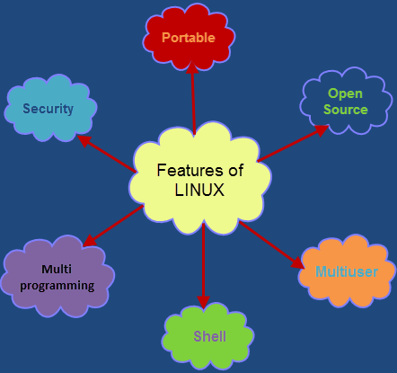
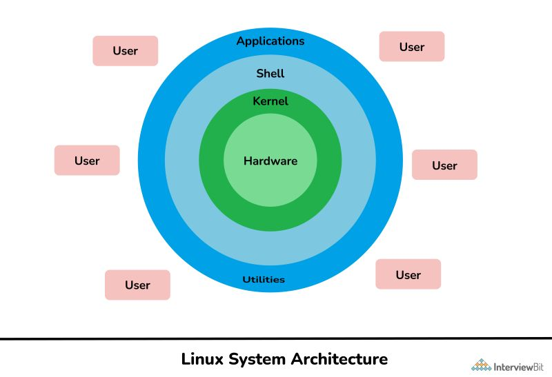
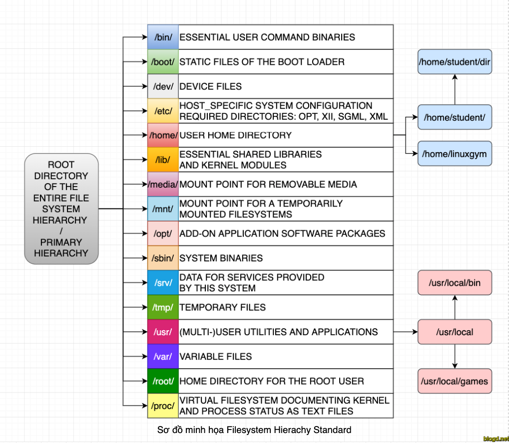
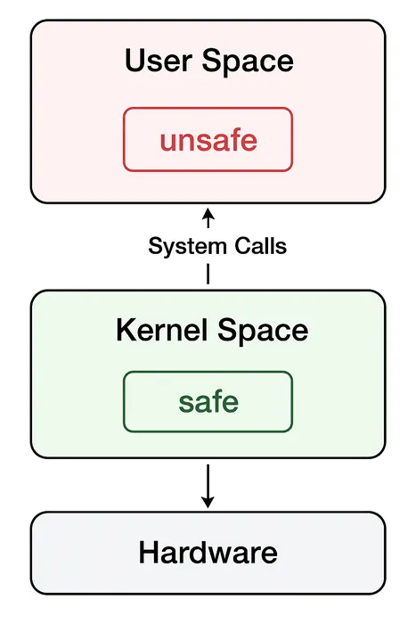
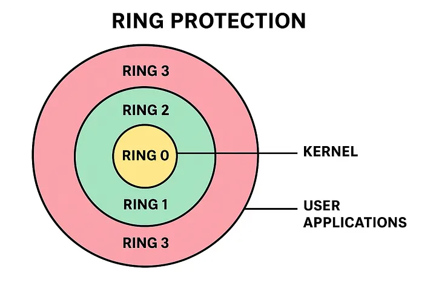
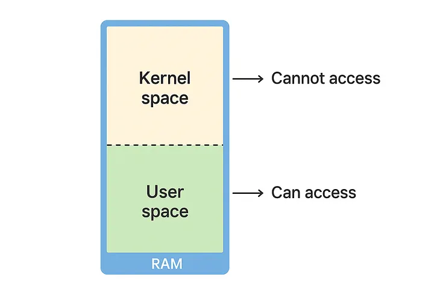
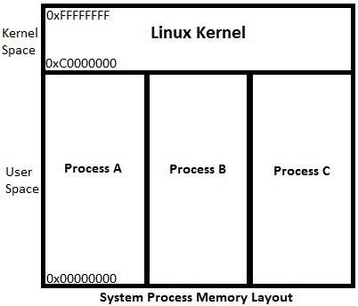
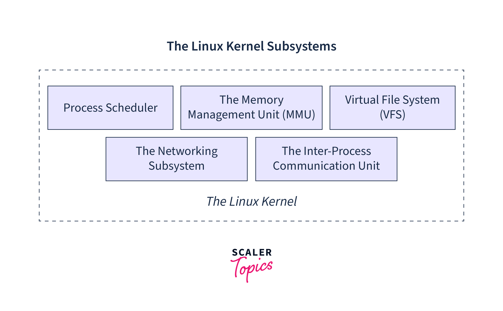

# Linux OS Overview & Kernel Module/Driver Basics

> **Session 8** — Linux Kernel Programming
> Core concepts of the Linux operating system: the user space/kernel space split, the kernel's major subsystems, kernel modules and device drivers.

## Table of Contents

1. [What Is an Operating System?](#1-what-is-an-operating-system)
2. [Linux and Its Main Components](#2-linux-and-its-main-components)
3. [User Space vs. Kernel Space](#3-user-space-vs-kernel-space)
4. [Linux Kernel Components Overview](#4-linux-kernel-components-overview)
5. [Linux Kernel Modules (LKM)](#5-linux-kernel-modules-lkm)
6. [Drivers: Bridging Hardware and the Kernel](#6-drivers-bridging-hardware-and-the-kernel)
7. [Module Lifecycle](#7-module-lifecycle)

---

## 1. What Is an Operating System?

At its core, an **operating system** (OS) is a special piece of software that sits between the hardware and the programs/users. It manages all of the computer's resources (CPU, RAM, disks, peripherals) and provides an environment in which other programs can run.

Applications do not "talk" to the hardware directly. Every request — reading a file, drawing on the screen, sending data over the network — has to go through the operating system.

***Why do we need an operating system?***

Without an OS, every programmer would have to write code that drives each hardware component directly, and everything would be chaos. The operating system solves four core problems:

1. **Hardware abstraction** (hiding complexity)
   Hardware is complex and diverse: every disk or network card vendor has its own way of controlling the device. The OS hides those details and exposes simple concepts such as *files*, *directories* and *windows*. A programmer just calls "open file" without needing to know which disk sector holds the data.

2. **Resource management and sharing**
   You can listen to music, browse the web and download a file at the same time, even though the CPU can only execute a limited number of instructions at any given moment. The OS slices CPU time into very small pieces and rotates between programs so quickly that they appear to run simultaneously. Likewise, it allocates RAM, divides disk space and arbitrates access to printers, the network, and so on.

3. **Protection and isolation**
   The OS ensures that one program cannot snoop on or corrupt another program's memory, and that a crashing application does not bring down the whole machine. It also enforces access control: which user may see which file.

4. **User interface**
   Through a graphical interface (GUI) or a command line (CLI), the OS lets people interact with the computer conveniently.

---

## 2. Linux and Its Main Components

"Linux" originally referred only to a **kernel**, written in 1991 by Linus Torvalds while he was a student in Finland. The Linux kernel is combined with a large amount of other software (notably the tools from the GNU project) to form a complete operating system.

***Three defining characteristics of Linux***

- **Open source** — The source code is released under the GPL; anyone can read, modify and redistribute it. This is why there are hundreds of different Linux variants.
- **Unix-like** — Linux follows the philosophy and structure of Unix (which dates back to the 1970s), but it was written from scratch and contains no Unix code.
- **Multi-user and multitasking** — By design, many people can share one machine, each with their own permissions, and many programs can run concurrently.

***What is a distribution?***

Because the kernel and the accompanying software are free, different organizations package them in their own way, with their own package manager, default configuration and user interface. Each such package is called a **distro** — for example Ubuntu, Debian, Fedora, Red Hat Enterprise Linux and Arch Linux. They all share the Linux kernel and differ only in the outer "shell".

**Main components**



A Linux system is organized as nested layers, from the inside out: **Hardware → Kernel → Shell → Applications & Utilities**. Each layer talks only to its neighbour; users on the outside never touch the hardware directly.

*1. Hardware*

The innermost layer: the physical devices — CPU, RAM, disks, network cards, keyboard, display and other peripherals. Hardware only understands low-level signals and registers and knows nothing about files, processes or users. Only the kernel may access this layer directly.

*2. Kernel*

The heart of the system. It runs at the highest privilege level (kernel space) and is the only part allowed to touch the hardware directly. The kernel is responsible for:

- Process management and CPU scheduling
- Memory management
- File system management
- Device control through drivers
- Networking
- Providing essential services to higher-level software through **system calls** (e.g. `read()`, `write()`, `fork()`)

The Linux kernel is **monolithic**: almost all of its functionality lives in a single block running in kernel space, which makes it fast. It stays flexible thanks to **kernel modules**: drivers can be loaded or unloaded at runtime without rebooting.

*3. Shell*

The intermediate layer between the user and the kernel. The shell takes the commands you type, interprets them and asks the kernel to execute them (via system calls). The most popular is **Bash**; others include Zsh and Fish.

The shell is one of Linux's great strengths: you can chain small commands into complex pipelines with `|`, or write **shell scripts** to automate work.

*4. Applications*

The outermost layer: the programs people use every day — web browsers, editors, IDEs, music players, web servers, databases… Applications run in **user space** and never access hardware directly; every request (reading a file, sending data over the network, drawing on the screen) goes through the kernel, usually via system libraries such as **glibc**.

*5. Utilities*

On the same layer as applications: the basic command-line toolset for working with the system — `ls`, `cp`, `mv`, `grep`, `cat`, `chmod`, `ps`, `top`… Mostly from the GNU project. Each tool does one small job well, following the Unix philosophy, and they are combined through the shell.

**Other components**

- **Bootloader** — the first program to run at power-on; it loads the kernel into memory and hands control to it. The most common is **GRUB**, which also lets you choose an OS when Windows and Linux are installed side by side.
- **System calls** — the only "door" between user space and the kernel. The kernel checks permissions and then acts on the application's behalf.
- **System libraries** — such as **glibc**, which wrap system calls in convenient functions. For example, `printf()` issues the `write()` system call underneath.
- **Init system** — the first process (**PID 1**) started by the kernel after boot; it starts and manages every other service. Most distros today use **systemd**.
- **Daemons** — background programs waiting to serve requests, e.g. `sshd`, `cron`, `httpd`. Their names usually end with "d".
- **Graphical interface** — just an ordinary application and **optional**. Many Linux servers run with no GUI at all.

**File system**

Linux organizes everything into **a single directory tree** starting at the root `/`, rather than separate drives like `C:` and `D:` on Windows.

Important subdirectories of `/`:

| Directory | Contents |
|---|---|
| `/etc` | System configuration files |
| `/bin`, `/sbin` | Essential commands and executables for users and administrators |
| `/dev` | Files representing hardware and peripheral devices |
| `/lib` | Shared libraries and kernel modules |
| `/boot` | The kernel image and bootloader files |
| `/home` | Home directories of regular users |
| `/root` | Home directory of the root account — **not** the same as the root directory `/` |
| `/var` | Frequently changing data such as logs and caches |
| `/tmp` | Temporary files, usually cleared on reboot |

***Two core philosophies***

> **"Everything is a file."**
> In Linux, not only documents but also hardware devices (`/dev/sda` is a disk), process information (`/proc`) and network connections are represented as files. As a result, the same set of read/write tools works on a huge range of things.

> **"Do one thing and do it well."**
> Instead of one giant program that does everything, Linux has many small tools that are combined through pipes `|`. For example, the following counts the error lines in a log file by chaining three simple tools:
>
> ```bash
> cat log.txt | grep error | wc -l
> ```

---

## 3. User Space vs. Kernel Space

### 3.1. Concepts

- **Kernel space** is the CPU's privileged execution mode together with the address range reserved for the OS kernel. Code running here has full control of the hardware: it can execute any instruction, access any memory, and control devices and interrupts.
- **User space** The User Space is the domain where user applications and processes operate. It is the area where most user-level programs, such as software applications and utilities, execute. User Space does not have direct access to memory or hardware. It connects to the hardware via kernel space. User-space processes or programs can only access some parts of memory via system calls. Crashes in user mode are recoverable due to complete protection. The GNU C library in the user space provides the mechanism for switching user space applications to the kernel space.
The purpose of this split is **isolation and protection**: a buggy or malicious program cannot break the system or read another process's data.



### 3.2. Hardware mechanisms

The boundary is enforced by the **CPU** and the **MMU**; software cannot sneak around it. There are three main mechanisms.

**① CPU privilege levels**

x86 has "rings": the kernel runs in **Ring 0** and applications run in **Ring 3**. On ARM the equivalents are **EL1** and **EL0**. Some instructions are privileged — for example disabling interrupts (`cli`), switching page tables (`mov cr3`) or accessing I/O ports. If an application executes them in Ring 3, the CPU raises an exception and the kernel usually kills the process.



**② The U/S bit in page tables**

Each memory page has a bit marking it as **User** or **Supervisor**. If the CPU is in user mode and accesses a Supervisor page, the MMU blocks the access and raises a **page fault**. On Linux you see the result as a `Segmentation fault`.

**③ Legitimate entry gates**

The only way to go from user mode to kernel mode is through "doors" defined by the kernel: the `syscall` instruction, hardware interrupts, or exceptions such as a page fault or divide-by-zero. An application cannot jump to an arbitrary address inside the kernel.



### 3.3. Memory: the address space

***Virtual address space layout***

Each process has its **own user space**: the same virtual address, e.g. `0x400000`, in two different processes points to two different physical pages. In contrast, **kernel space is mapped identically into every process**. Thanks to this, a system call does not need to switch page tables — the CPU only needs to change mode to run kernel code.



***Protection mechanisms***

Every page table entry has a U/S (User/Supervisor) bit. Kernel pages are marked "Supervisor only"; user-mode code that touches them triggers a page fault.

Additional hardening mechanisms:

| Mechanism | Effect |
|---|---|
| **SMEP** | The kernel may not *execute* code located in user pages |
| **SMAP** | The kernel may not *read/write* user pages unless it explicitly allows it |
| **KPTI** | Introduced after the Meltdown vulnerability: while in user mode, most of the kernel is unmapped from the page tables |

This is why the kernel can never blindly trust a pointer supplied by user space. It must use functions such as `copy_from_user()` / `copy_to_user()` to validate and copy data across the boundary.

### 3.4. Process and execution differences

A process typically moves back and forth between the two modes. Normally it runs in user mode. When it makes a system call, the same process switches to kernel mode so the kernel can do work "on its behalf", then returns.

**Three ways into kernel space:**

| Path | Description | Examples |
|---|---|---|
| **System call** | Deliberate request, via the `syscall` (x86-64) or `svc` (ARM) instruction | `read`, `write`, `fork`, `mmap` |
| **Exception** | Synchronous fault caused by the currently executing instruction | Page fault, divide-by-zero |
| **Interrupt** | Asynchronous event from hardware | Timer, network card, keyboard |

**Kernel threads** are entities that live only in kernel space, e.g. `kworker`, `ksoftirqd`, `kswapd`. They have no user space part (their `mm` field is `NULL`) and never return to user mode.

***Mode switch ≠ Context switch***

A common point of confusion:

| | Mode switch | Context switch |
|---|---|---|
| **What it is** | Same process, only switching user mode ↔ kernel mode | Switching to a different process |
| **Cost** | Relatively cheap (on the order of hundreds of nanoseconds), though KPTI makes it more expensive | Much more expensive: save/restore registers, switch page tables, cache/TLB disruption |

> One system call causes **two mode switches**, but not necessarily a context switch.

---

## 4. Linux Kernel Components Overview

The Linux kernel is **monolithic**, but it is organized in a **modular** way: the source is split into subsystems, each responsible for one kind of resource, and they cooperate to serve processes in user space. The core subsystems are:

- **Process Scheduler**
- **Memory Management**
- **Virtual File System (VFS)**
- **Networking Subsystem**
- **Inter-Process Communication (IPC)**
- **Device Drivers** (often counted as the sixth subsystem)



> **A note on terminology:** the figure labels the memory block "Memory Management Unit (MMU)". Strictly speaking, **the MMU is a hardware unit** inside the CPU that translates virtual addresses to physical ones. What lives in the kernel is the **memory management subsystem** (the `mm/` directory), which builds and maintains the page tables the MMU uses. Likewise, IPC is tightly coupled to process management in the actual source, so many texts treat the two as one.

### 4.1. The common principle

Every subsystem does the same three things:

1. **Manage a real, limited resource** (CPU, RAM, disk, network card…).
2. **Share** that resource safely among many processes.
3. **Present an "illusion"** (abstraction) that is simpler than the real resource.

| Subsystem | Real resource | Illusion given to programs | Core data structures | User-space interface | Source |
|---|---|---|---|---|---|
| Process management | CPU | "I have my own CPU" | `task_struct`, run queue | `fork`, `exec`, `exit`, `wait`, `kill` | `kernel/` |
| Memory management | RAM | "I have a large, contiguous memory region all to myself" | `mm_struct`, `vm_area_struct`, `struct page` | `mmap`, `brk`, `munmap` | `mm/` |
| VFS | Storage devices | "Everything is a named stream of bytes" | `superblock`, `inode`, `dentry`, `file` | `open`, `read`, `write`, `close` | `fs/` |
| Networking | Network card | "I have a reliable channel to another machine" | `socket`, `sock`, `sk_buff`, `net_device` | `socket`, `bind`, `send`, `recv` | `net/` |
| IPC | Memory, synchronization | "Processes can talk to each other" | `pipe_inode_info`, `futex`, `shmid_kernel` | `pipe`, `shmget`, `futex`, `kill` | `ipc/`, `kernel/` |
| Drivers | Hardware devices | "A device is a file / an interface" | `device`, `device_driver`, `file_operations` | `/dev`, `ioctl` | `drivers/` |

There are also cross-cutting pieces shared by every subsystem: the **system call interface**, **interrupt handling** (interrupts, softirqs), **synchronization primitives** (spinlocks, mutexes, RCU) and the CPU-architecture-specific code (`arch/`).

### 4.2. Process management and the scheduler

***Processes and threads in the kernel***

The kernel does not distinguish between processes and threads: both are **tasks**, each described by a `task_struct`. The only difference is what a task **shares** with other tasks. Both `fork()` and `pthread_create()` go through the `clone()` system call, whose flags decide what is shared:

| `clone()` flag | Shared |
|---|---|
| `CLONE_VM` | Address space (`mm_struct`) |
| `CLONE_FILES` | File descriptor table |
| `CLONE_FS` | Root and current working directory |
| `CLONE_SIGHAND` | Signal handler table |
| `CLONE_THREAD` | Same thread group (same PID as seen from user space) |

- A **process** is a task that shares nothing (it gets its own copy of everything).
- A **thread** is a task that shares almost everything with its parent.
- The PID seen in user space is actually the **TGID** (thread group ID); each thread has its own PID inside the kernel.

A `task_struct` holds: PID/TGID, state, the `mm` pointer (memory), `files` (open files), `fs`, `signal`, `cred` (credentials), scheduling data (`sched_entity`), and parent–child links.

***Process states***

| Kernel state | `ps` letter | Meaning |
|---|:---:|---|
| `TASK_RUNNING` | `R` | Running, or waiting in the run queue |
| `TASK_INTERRUPTIBLE` | `S` | Sleeping on an event; can be woken by a signal |
| `TASK_UNINTERRUPTIBLE` | `D` | Sleeping on I/O; **cannot** be woken by a signal |
| `__TASK_STOPPED` | `T` | Stopped (e.g. received `SIGSTOP`, Ctrl+Z) |
| `EXIT_ZOMBIE` | `Z` | Finished, but the parent has not yet called `wait()` to collect its exit code |

***Process lifecycle***

1. **`fork()`** — the kernel calls `copy_process()` to build a new `task_struct`. Memory is not copied but shared **copy-on-write**, which makes `fork()` very fast.
2. **`exec()`** — replaces the entire address space with a new program (loads an ELF file), keeping the PID and file descriptors.
3. **`exit()`** — frees memory, closes files and sends `SIGCHLD` to the parent; the task becomes a **zombie**.
4. **`wait()`** — the parent collects the exit code and only then is the `task_struct` removed. If the parent dies first, the child is re-parented to `init` (PID 1).

***The scheduler***

The scheduler decides **which task runs, on which CPU, and for how long**. Each CPU has its own **run queue**, and the kernel periodically balances load across CPUs.

Tasks belong to **scheduling classes**, checked in decreasing priority order — a higher class always runs first:

| Class | Policy | Used for |
|---|---|---|
| Stop | — | Internal kernel work (migration…) |
| Deadline | `SCHED_DEADLINE` | Tasks with hard deadlines (EDF) |
| Real-time | `SCHED_FIFO`, `SCHED_RR` | Real-time tasks, priority 1–99 |
| Fair | `SCHED_NORMAL`, `SCHED_BATCH` | Almost every ordinary process |
| Idle | `SCHED_IDLE` | Work that runs only when the CPU is otherwise idle |

For the **Fair** class, the core idea is **sharing the CPU fairly by weight**:

- **CFS** (Completely Fair Scheduler, used from 2.6.23 to 6.5): every task has a **`vruntime`** — virtual run time that grows more slowly for higher-priority tasks (lower `nice`). Tasks are kept in a **red-black tree** ordered by `vruntime`; the scheduler always picks the task with the smallest `vruntime`, i.e. the one that has been treated least fairly.
- **EEVDF** (Earliest Eligible Virtual Deadline First, since kernel 6.6): keeps the fair-share principle but also gives each task a **virtual deadline**. Among the "eligible" tasks (those that have not received more than their share), it picks the one with the earliest deadline, which serves latency-sensitive tasks better.

**Preemption:** the periodic timer interrupt updates the current task's run time. When the task has used up its share or a more important task wakes up, the kernel sets the `need_resched` flag; the switch happens at the next safe point (on return to user space, or inside the kernel if it is configured as preemptible). `schedule()` picks the next task, then `context_switch()` switches page tables (`switch_mm`) and registers/stack (`switch_to`).

### 4.3. Inter-process communication (IPC)

Because each process has its own address space, processes cannot read each other's memory. IPC is the set of kernel-provided mechanisms for crossing that isolation in a controlled way:

| Mechanism | What it is | Characteristics |
|---|---|---|
| **Signal** | Asynchronous notification (`SIGINT`, `SIGKILL`, `SIGCHLD`…) | Carries only a number, no data |
| **Pipe / FIFO** | Ring buffer in the kernel, accessed via file descriptors | One-way byte stream; a FIFO has a name in the file system |
| **Message queue** | Message queue in the kernel (System V / POSIX) | Preserves message boundaries |
| **Shared memory** | The same physical pages mapped into several processes | Fastest (no copying), but you must synchronize yourself |
| **Semaphore** | Synchronization counter (System V / POSIX) | Typically paired with shared memory |
| **Futex** | A sync variable in user space; enters the kernel only under contention | The foundation of `pthread_mutex` and `pthread_cond` |
| **Unix domain socket** | A socket local to the machine | Bidirectional; can even pass file descriptors |

What they share: every mechanism goes through the kernel at setup time, because only the kernel can "connect" address spaces that are otherwise isolated.

### 4.4. Memory management

***Virtual memory and paging***

- Memory is divided into **pages**, typically 4 KB.
- Each process has its own **page tables** mapping virtual pages → physical page frames. On x86-64, page tables have 4 or 5 levels (PGD → P4D → PUD → PMD → PTE).
- The **MMU** (hardware) walks the page tables automatically on every memory access and caches results in the **TLB**. The kernel only steps in on a **page fault**.

***A process's address space***

The address space (`mm_struct`) is divided into contiguous regions called **VMAs** (`vm_area_struct`), each with its own permissions and backing:

| Region | Contents | Permissions |
|---|---|---|
| Text | Program code | `r-x` |
| Data / BSS | Global variables | `rw-` |
| Heap | Dynamic allocations (`malloc`, grown with `brk`) | `rw-` |
| Mmap | Shared libraries, `mmap`ed files, large `malloc` regions | Varies |
| Stack | The stack, growing down from high addresses | `rw-` |

Inspect a process's VMAs with `cat /proc/<pid>/maps`.

***Demand paging: lazy allocation***

`malloc()` or `mmap()` only creates or extends a VMA — **no real RAM is allocated yet**. Only when the program first touches a page does a page fault occur, and the kernel then assigns a physical frame. There are three kinds of page fault:

- **Minor fault** — the page is already in RAM (e.g. in the page cache); only the page table needs updating.
- **Major fault** — data must be read from disk (a file or swap); the process sleeps while waiting.
- **Invalid fault** — the address belongs to no VMA or violates permissions → the kernel sends `SIGSEGV` (Segmentation fault).

This is also why Linux allows **overcommit**: the total memory processes "ask for" can exceed physical RAM.

***Physical memory management***

- Each physical page frame is described by a `struct page`. RAM is divided into **zones** (`ZONE_DMA`, `ZONE_DMA32`, `ZONE_NORMAL`) according to hardware limits, and into **nodes** on NUMA machines.
- The **buddy allocator** hands out blocks of 2ⁿ contiguous pages (order 0 to 10). On free, two adjacent "buddy" blocks are merged to reduce fragmentation. Inspect it with `cat /proc/buddyinfo`.
- The **slab allocator** (SLUB today) carves pages into small, equally sized objects for kernel structures that are created and destroyed constantly (`task_struct`, `inode`, `dentry`…). Inspect it with `sudo slabtop`.
- APIs for kernel code: `kmalloc()` (physically contiguous, slab-backed), `vmalloc()` (contiguous only in virtual addresses, for large regions), `alloc_pages()` (pages straight from the buddy allocator).

***Reclaiming memory under pressure***

- Pages come in two kinds: **file-backed** (page cache — can be dropped and re-read from the file) and **anonymous** (heap, stack — must be written to **swap** before being reclaimed).
- The kernel tracks pages on **LRU lists** (active/inactive) to pick the least recently used ones.
- The **`kswapd`** thread reclaims pages in the background when free memory drops below a watermark; if it can't keep up, the allocating process must reclaim on its own (direct reclaim).
- When nothing more can be reclaimed, the **OOM killer** picks and kills the process using the most memory to save the system.

### 4.5. Virtual File System (VFS)

***Role***

The VFS is the abstraction layer that makes every file system look the same to applications. Thanks to it, the same `read()` call works on ext4, NTFS, NFS, `/proc` or a device in `/dev`. The VFS defines the **common interface**, and each concrete file system supplies the implementations (through ops tables).

***The four core objects***

| Object | Represents | Ops table | Notes |
|---|---|---|---|
| `superblock` | A mounted file system | `super_operations` | Block size, inode count, state |
| `inode` | A specific file (metadata) | `inode_operations` | Permissions, owner, size, data location — **no file name** |
| `dentry` | One component of a path (name → inode) | `dentry_operations` | Cached in the **dcache** for fast path lookup |
| `file` | One open instance of a file by a process | `file_operations` | Holds the current read/write position (offset) and open mode |

Because the file name lives in the dentry rather than the inode, one inode can have several names — that is exactly what a **hard link** is. A file is only truly deleted when no name points to it and nobody has it open.

***From file descriptor to data***

```text
Process ──► fd table (files_struct) ──► struct file ──► dentry ──► inode ──► data on disk
              fd = 3                       offset         name       metadata
```

- A **file descriptor** is just an index into the process's table of open files.
- Two processes opening the same file get two separate `struct file`s (separate offsets) but share the inode.
- After `fork()`, parent and child share the same `struct file` and therefore the same offset.

***Kinds of file systems***

- **On-disk:** ext4, xfs, btrfs, vfat.
- **Network:** NFS, CIFS/SMB.
- **Pseudo:** `procfs` (`/proc` — process information), `sysfs` (`/sys` — devices and drivers), `tmpfs` (lives entirely in RAM), `devtmpfs` (`/dev`).

***Page cache and delayed writes***

- Reads: data is loaded into the **page cache**; later reads come straight from RAM.
- Writes: `write()` only copies data into the page cache, marks the page **dirty** and returns immediately. Writeback threads flush it to disk later (after a few seconds by default). To be sure data is on disk you must call `fsync()`.
- File systems such as ext4 use **journaling**: changes are logged first so the file system can be recovered consistently after a power loss.

### 4.6. The networking subsystem

***Layered architecture***

| Layer | Kernel components | Role |
|---|---|---|
| Socket | `struct socket`, `struct sock` | BSD socket interface for applications; a socket is a file descriptor |
| Transport | TCP, UDP | Connections, reliability, congestion control (TCP), ports |
| Network | IPv4/IPv6, routing table, **netfilter** | Packet routing, filtering and NAT |
| Link | `net_device`, transmit queues (qdisc) | Dispatching packets to each interface |
| Driver | Network driver | Talks to the NIC through DMA and interrupts |

***`sk_buff`: the central structure***

Every packet is represented by an `sk_buff` (socket buffer). It holds a pointer to the data area plus pointers to each layer's header. On the way down, each layer just **prepends its header** (`skb_push`); on the way up, each layer **strips its header** (`skb_pull`). The payload is never copied between layers — this is the key to the network stack's performance.

***Transmit and receive paths***

- **Transmit:** `send()` → socket → TCP (segmentation, header) → IP (routing, header) → qdisc → driver → NIC (DMA).
- **Receive:** NIC writes the packet into RAM (DMA) → interrupt → driver schedules **NAPI** → `NET_RX` softirq pulls packets in batches → IP → TCP → socket buffer → wakes the process waiting in `recv()`.

NAPI combines interrupts with polling: under heavy traffic the driver disables interrupts and reads many packets at once, so the CPU isn't flooded with interrupts.

***Netfilter***

Netfilter provides **hooks** along a packet's path: `PREROUTING`, `INPUT`, `FORWARD`, `OUTPUT`, `POSTROUTING`. Firewall tools such as **iptables** and **nftables** attach rules to these hooks to filter, forward or translate addresses (NAT).

The kernel also supports **network namespaces**: each namespace has its own interfaces, routing table and firewall rules — the networking foundation of containers (Docker, Kubernetes).

### 4.7. Device drivers

Drivers are the layer that talks directly to hardware and make up most of the kernel source (`drivers/`). They translate generic requests ("read block N", "send this Ethernet frame") into concrete operations on each device's registers, interrupts and DMA.

- **Three kinds of driver:** character devices (byte streams), block devices (blocks of data, via the block layer), network devices (packets, via the network stack).
- **Device model:** the kernel manages devices with a **bus – device – driver** model; when a device matches a driver, the driver's `probe()` is called. The whole device tree is exposed under `/sys`.
- Because of drivers, the subsystems above don't need to know which vendor made your disk or network card.

How drivers work is covered in detail in [section 6](#6-drivers-bridging-hardware-and-the-kernel).

### 4.8. How the subsystems relate to each other

```text
┌──────────────────────────────────────────────────────────┐
│                 Applications (user space)                │
└────────────────────────────┬─────────────────────────────┘
                             ▼
┌──────────────────────────────────────────────────────────┐
│                  System call interface                   │
└────────────────────────────┬─────────────────────────────┘
                             ▼
┌─ Kernel space ───────────────────────────────────────────┐
│ ┌──────────────────────────┐ ┌─────────────────────────┐ │
│ │    Process management    │ │    Memory management    │ │
│ │ scheduling, tasks, IPC   │ │ virtual memory, paging, │ │
│ │                          │ │ allocation              │ │
│ └──────────────────────────┘ └─────────────────────────┘ │
│ ┌──────────────────────────┐ ┌─────────────────────────┐ │
│ │    File system (VFS)     │ │      Network stack      │ │
│ │ ext4, xfs, page cache    │ │ socket, TCP/IP, sk_buff │ │
│ └────────────┬─────────────┘ └────────────┬────────────┘ │
│              ▼                            ▼              │
│ ┌──────────────────────────────────────────────────────┐ │
│ │                    Device drivers                    │ │
│ │              block, network, char device             │ │
│ └──────────────────────────────────────────────────────┘ │
└────────────────────────────┬─────────────────────────────┘
                             ▼
┌──────────────────────────────────────────────────────────┐
│          Hardware: CPU, RAM, disk, network card          │
└──────────────────────────────────────────────────────────┘
```

The key point: these subsystems are **not stacked as isolated layers**. Linux is a monolithic kernel: everything runs in one address space and calls each other's functions directly. The diagram above is a simplified view; in reality they form a web of dependencies, with a few main links.

**Process ↔ Memory: the tightest coupling**
- Each `task_struct` points to an `mm_struct` describing that process's address space.
- When the scheduler switches from process A to B (a context switch), it must switch page tables.
- When `fork()` creates a child, memory is not copied right away; it is shared using **copy-on-write** and only copied when one side writes to it.
- When a process touches a page that is not in RAM, a page fault occurs, the process is put to sleep, and the scheduler runs another process while it waits.

**Memory ↔ File system: almost merged via the page cache**
- When you read a file, the data is loaded into RAM pages called the **page cache**; subsequent reads come straight from RAM.
- `mmap()` maps a file directly into the address space, so reading the file becomes a memory access.
- Conversely, swap uses the disk to extend RAM.
- This is why "free" RAM on Linux is usually being used as file cache.

**File system & Network → Drivers**
- A file system does not write to disk by itself. It creates I/O requests (`bio`) and sends them through the **block layer** (home of the I/O scheduler) to the block driver.
- The network stack works the same way: it hands an `sk_buff` to the network driver for transmission. On receive, the driver gets an interrupt from the NIC and pushes the packet back up the stack.

**Network ↔ Process: connected through the VFS**
- The "everything is a file" philosophy shows clearly here: a socket is a file descriptor.
- Processes use the same `read()` and `write()` for both files and sockets, with the VFS as the common gateway. Devices are also exposed as files in `/dev`.
- The VFS is the glue between processes and almost every other resource.

**Memory is a foundation service for everyone**
- Every subsystem allocates its data structures through the slab allocator: `task_struct`, `inode`, `sk_buff`.
- Drivers need memory regions suitable for DMA.
- When a subsystem waits for I/O, it asks the scheduler to put the process to sleep and wake it up later.
- Hence **process management** and **memory management** are the two foundation services that the other three subsystems depend on.

### 4.9. An end-to-end example

A web server calls `read()` on a file and then sends its contents over the network:

1. The call enters the **VFS** through a system call.
2. The VFS checks the **page cache**, i.e. it asks memory management.
3. If the data is not cached, **ext4** issues an I/O request to the block driver, and the **scheduler** puts the process to sleep.
4. The disk writes the data into RAM via **DMA**, then raises an interrupt.
5. The **driver** wakes the process up.
6. The process calls `write()` on a socket; the call again goes through the VFS into the **network stack**.
7. TCP/IP packs the data into an `sk_buff` and passes it to the **network driver**, which sends it out through the NIC.

> A single simple operation passes through all five subsystems.

---

## 5. Linux Kernel Modules (LKM)

### 5.1. Definition

A **kernel module** is an independently compiled unit of kernel code. It provides a specific piece of functionality to the kernel and can be integrated in one of two forms: **built-in** or **loadable**.

A **Loadable Kernel Module (LKM)** is a kernel module packaged as a separate object file (the `.ko` format — *kernel object*). An LKM has three properties:

- **Dynamic loading** — it can be linked into the kernel while the system is running.
- **Dynamic unloading** — it can be detached from the kernel when no longer needed.
- **No change to the base kernel image** — adding or removing a module requires neither recompiling nor rebooting the kernel.

### 5.2. The nature of a module

- **Execution environment** — A module runs in kernel space at the CPU's highest privilege level. Once loaded, its code is part of the kernel, sharing the kernel's address space and privileges.
- **No isolation** — A bug in a module directly affects the entire kernel.
- **Interface with the kernel** — A module may only use functions and variables that the kernel explicitly *exports*. In turn, a module can export its own symbols for other modules, which creates dependencies between modules.
- **Lifecycle** — Every module has two entry points:
  - **Init function**: called when the module is loaded; registers the module's functionality with kernel subsystems.
  - **Exit function**: called when the module is unloaded; unregisters and frees resources.
- **Metadata** — Each module carries descriptive information: license, author, description, parameters, dependencies, and the devices it supports.
- **Version compatibility** — A module must be compiled against the exact version and configuration of the kernel that will load it.

### 5.3. Functionality commonly implemented as modules

- Device drivers
- File systems
- Network protocols and components
- Cryptographic algorithms
- Other kernel extension mechanisms, e.g. packet filters or security frameworks

### 5.4. Why modules exist

The Linux kernel is **monolithic**: all OS services run in a single kernel space. Modules were introduced to overcome the limitations of having every feature statically linked:

- **Runtime extensibility** — add functionality without rebooting the system.
- **Resource efficiency** — only the features actually needed for the current hardware and configuration are loaded into memory.
- **Kernel generality** — a single kernel can support many hardware configurations; the necessary components are loaded based on the hardware actually detected.
- **Modular development and maintenance** — each component can be built, tested, updated and replaced independently.
- **Out-of-tree support** — components that are not part of the official kernel source can still be integrated.

### 5.5. Built-in vs. loadable modules

When configuring the kernel, each component is set to one of three states:

| Value | Meaning |
|:---:|---|
| `y` | Built-in |
| `m` | Loadable module |
| `n` | Not compiled |

**Comparison:**

| Aspect | Built-in (`=y`) | Loadable (`=m`) |
|---|---|---|
| **Definition** | Statically linked into the kernel image at build time | Compiled into a separate `.ko` file, dynamically linked when needed |
| **When it takes effect** | Initialized during kernel boot | After being loaded (manually, or automatically when hardware is detected) |
| **Removal** | Not possible | Possible when no longer in use |
| **Memory** | Always occupied, whether used or not | Only while loaded |
| **Parameters** | Via the kernel command line | At module load time |
| **Dependencies** | Resolved at build time | Must be resolved at load time |
| **Storage** | Inside the kernel image | On the file system; if needed for boot, it must be in the **initramfs** |
| **Used for** | Components required before the root file system is available | Most drivers and optional features |
| **Security** | — | An entry point for injecting code into the kernel, so usually paired with **module signing** |

**What they have in common:**

- The same source code can be built either way. The functionality is identical; only the time and manner of integration differ.
- In both cases, once integrated, the module's code runs in kernel space with full privileges.

---

## 6. Drivers: Bridging Hardware and the Kernel

```text
┌──────────────────────────────────────────────────────────┐
│     Applications: open, read, write, ioctl, socket       │
└────────────────────────────┬─────────────────────────────┘
                             ▼
┌──────────────────────────────────────────────────────────┐
│                  System calls and VFS                    │
└───────┬────────────────────┬────────────────────┬────────┘
        ▼                    ▼                    ▼
┌────────────────┐   ┌────────────────┐   ┌────────────────┐
│  Char device   │   │  Block layer   │   │   Net device   │
│cdev, tty, input│   │  bio, blk-mq   │   │net_dev, sk_buff│
└───────┬────────┘   └───────┬────────┘   └───────┬────────┘
        ▼                    ▼                    ▼
┌─ Driver ─────────────────────────────────────────────────┐
│ ┌──────────────────────────────────────────────────────┐ │
│ │      Upper side: implements kernel callbacks         │ │
│ │        file_operations, net_device_ops               │ │
│ └──────────────────────────┬───────────────────────────┘ │
│                            ▼                             │
│ ┌──────────────────────────────────────────────────────┐ │
│ │      Lower side: controls the hardware               │ │
│ │        registers, interrupts, DMA                    │ │
│ └──────────────────────────────────────────────────────┘ │
└────────────────────────────┬─────────────────────────────┘
                             ▼
┌──────────────────────────────────────────────────────────┐
│          Bus core: PCI, USB, I2C, SPI, platform          │
└────────────────────────────┬─────────────────────────────┘
                             ▼
┌──────────────────────────────────────────────────────────┐
│          Hardware: chips, registers, buffers             │
└──────────────────────────────────────────────────────────┘
```

A driver is code running in kernel space with **two interfaces**:

- **Upper side** — implements functions following the interface the kernel defines for each device type.
- **Lower side** — reads/writes registers, handles interrupts and configures DMA according to the specification of one particular device.

The rest of the kernel never accesses the device directly, and the device knows nothing about files or sockets. The driver translates between the two.

### 6.1. The kernel-facing side

The kernel defines **frameworks** for each device type. Each framework specifies a structure of function pointers (an **ops table**). The driver supplies its own functions and assigns them to that structure.

| Type | Used for | How it registers | Visible to user space as |
|---|---|---|---|
| **Character device** | Byte-stream access: serial ports, sensors, keyboards | Assigns `open`, `read`, `write`, `ioctl` in a `struct file_operations` | A file in `/dev` |
| **Block device** | Block-based storage: SSDs, memory cards | Receives I/O requests already sorted, merged and scheduled by the file system and block layer — never a direct `read()` from an application | A file in `/dev` |
| **Network device** | Network cards | Registers a `struct net_device` (e.g. `eth0`) with `ndo_start_xmit` for transmit; on receive, passes `sk_buff`s up the network stack | **No** file in `/dev` |

Example ops table for a character device:

```c
static const struct file_operations my_fops = {
    .open           = my_open,
    .read           = my_read,
    .write          = my_write,
    .unlocked_ioctl = my_ioctl,
};
```

When an application calls `read()` on `/dev/mydev`, the VFS does not check the device type. It fetches the ops table attached to that file and calls the function in the `.read` field — here, `my_read`. Because the call goes indirectly through a function pointer, the same `read()` system call can reach any driver's function without changing VFS code.

### 6.2. The hardware-facing side

Drivers use three mechanisms:

- **Registers (MMIO or port I/O)** — Device registers are mapped into the address space. The driver uses functions such as `readl()` and `writel()` to issue commands (e.g. start a transfer) or read status (e.g. has the operation completed?).
- **Interrupts** — The device signals the CPU with an interrupt when something happens (a new packet arrived, a write completed…). The driver registers an interrupt handler, split into two stages:
  - **Top half**: runs immediately in interrupt context, does the bare minimum and must finish quickly.
  - **Bottom half** (softirq, tasklet, workqueue, or NAPI for networking): performs the time-consuming processing.
- **DMA** — For large blocks of data, the CPU doesn't copy byte by byte. The driver gives the device the address of a RAM region, and the device reads/writes data there on its own. This memory is allocated through the memory management subsystem's DMA API.

### 6.3. The device model: how the kernel binds drivers to devices

Drivers do not probe for hardware themselves. Linux uses a **device model** with three parts: **bus**, **device** and **driver**.

1. The **bus core** (PCI, USB, I2C, SPI, platform) discovers the devices present in the system. Each device is identified by an ID (vendor ID/device ID) or by a description in the device tree/ACPI.
2. Each driver declares the list of IDs it supports.
3. When a device's ID matches a driver, the kernel calls that driver's **`probe()`** function. In `probe()`, the driver initializes the hardware, allocates resources and registers with the appropriate framework.
4. When the device is removed, the kernel calls **`remove()`**.

The kernel exposes device and driver information under `/sys`. The user-space program **udev** receives device add/remove events and creates the corresponding files in `/dev`. Drivers are usually built as modules (`.ko`) and loaded on demand with `modprobe` — when you plug in a USB device, the kernel can load the matching driver module automatically.

### 6.4. Example: receiving a packet on a network card

1. The NIC writes the packet into RAM via DMA, then raises an interrupt.
2. The driver's interrupt handler temporarily disables the card's interrupts and schedules NAPI processing.
3. During NAPI, the driver reads packets from the DMA ring buffer, builds an `sk_buff` for each one and passes them up to the network stack.
4. The TCP/IP stack processes the packet and writes the data into the socket's buffer.
5. The process waiting in `recv()` is woken up.

> The driver only performs **steps 1 → 3**. Steps 4 and 5 are handled by generic kernel code.

### 6.5. Key takeaways

- **Drivers implement mechanism, not policy.** For example, a driver provides a way to set the fan speed, while deciding which speed to use and when is left to higher layers or user space.
- **Drivers run in kernel space with full privileges.** A single bad pointer access can hang the entire system. Drivers are the most common source of bugs and security vulnerabilities in the kernel. That's why Linux offers ways to run drivers in user space (**UIO**, **VFIO**) and supports writing drivers in **Rust** to reduce memory bugs.
- **The stable interface lives in the frameworks, not in the drivers.** The kernel keeps the system call and framework interfaces fixed, while drivers are written per device. As a result, applications that used `read()` or `socket()` years ago still run on new hardware.

---

## 7. Module Lifecycle

> init/exit functions · insmod/rmmod/modprobe · module parameters · dependencies

A module is an **ELF** object file (`.ko` extension) containing compiled kernel code that has not yet been linked into the kernel. The kernel can load a module into memory, link it against kernel symbols, run it while the system is live, and unload it when it is no longer needed. Most drivers in Linux distributions are built as `=m`.

A module goes through the following states:

```text
┌───────────────────────────────┐
│       .ko file on disk        │
│    /lib/modules/<version>/    │
└───────────────┬───────────────┘
                │ insmod / modprobe
                ▼
┌───────────────────────────────┐
│        Load and link          │
│ checks, relocation, symbols   │
└───────────────┬───────────────┘
                ▼
┌───────────────────────────────┐      ┌──────────────────────┐
│        Run init function      │─────▶│   init returns error │
│        state: COMING          │      │   module unloaded    │
└───────────────┬───────────────┘      └──────────────────────┘
                ▼
┌───────────────────────────────┐
│            Running            │
│          state: LIVE          │
└───────────────┬───────────────┘
                │ rmmod, when refcount = 0
                ▼
┌───────────────────────────────┐
│    Run exit function, free    │
│         state: GOING          │
└───────────────────────────────┘
```

### 7.1. Init and exit functions

Each module declares two functions: **init** runs when the module is loaded, **exit** runs when it is unloaded. A minimal module:

```c
#include <linux/module.h>
#include <linux/init.h>

static int __init hello_init(void)
{
    pr_info("hello: loaded\n");
    return 0;           /* 0 = success */
}

static void __exit hello_exit(void)
{
    pr_info("hello: unloaded\n");
}

module_init(hello_init);
module_exit(hello_exit);

MODULE_LICENSE("GPL");
MODULE_AUTHOR("Author Name");
MODULE_DESCRIPTION("Example module");
```

The **init function** returns an `int`:

- `0` — loaded successfully.
- A negative value — an error code, e.g. `-ENOMEM` or `-ENODEV`. The kernel aborts the load, frees all of the module's memory, and `insmod` reports the error to the user.

Typical init tasks are allocating resources and registering with kernel frameworks, e.g. `register_chrdev()`, `pci_register_driver()` or `platform_driver_register()`.

The **exit function** returns nothing. It must undo everything the init function registered and allocated, **in reverse order**. If any step is missed, the kernel is left holding pointers to freed code or data, causing a crash when the system later touches them.

***Handling partial failure in init***

If init successfully completes step A but fails at step B, it must **undo step A itself** before returning the error, because the kernel will **not** call the exit function in this case. Kernel code typically uses `goto` for this:

```c
static int __init my_init(void)
{
    int ret;

    ret = step_a();
    if (ret)
        return ret;

    ret = step_b();
    if (ret)
        goto undo_a;

    return 0;

undo_a:
    cleanup_a();
    return ret;
}
```

***The `__init` and `__exit` macros***

- `__init` places the function in the `.init.text` section. For built-in code, the kernel frees this section after boot completes; for modules, after init returns successfully. Therefore **an `__init` function must never be called after initialization**.
- `__exit` marks a function used only on module unload. If the module is built in, `__exit` functions are dropped entirely, since built-in code is never unloaded.

> **Notes**
> - A module with no exit function **cannot be unloaded** — `rmmod` will refuse unless the kernel was built with the forced-unload option.
> - `MODULE_LICENSE` declares the module's license. If it is not GPL-compatible, the kernel is marked **"tainted"** and the module cannot use symbols exported with `EXPORT_SYMBOL_GPL`.

### 7.2. Loading: `insmod`

`insmod` takes the path to a specific `.ko` file:

```bash
sudo insmod ./hello.ko
```

`insmod` **does not resolve dependencies**. It reads the file and calls the `finit_module()` system call; the kernel does the rest:

1. **Permission check** — the calling process must have `CAP_SYS_MODULE`.
2. **Signature check** — if module signature enforcement is enabled (mandatory with Secure Boot on many distros), modules without a valid signature are rejected.
3. **Version check** — compares the `vermagic` string (kernel version, SMP, preempt…) and symbol CRCs (if `CONFIG_MODVERSIONS` is enabled). A module built for a different kernel is rejected with `Invalid module format`.
4. **Memory allocation and relocation** — copies the module's sections into kernel memory and fixes up addresses in the code for the new location.
5. **Symbol resolution** — every function/variable the module uses but does not define (such as `printk`, `kmalloc`) must exist in the symbol table of the kernel or of an already loaded module. Otherwise the load fails and `dmesg` reports `Unknown symbol`.
6. **Parameter assignment** from the command line (see [7.4](#74-module-parameters)).
7. **Run the init function** — the module is in `MODULE_STATE_COMING`. If init returns `0`, it moves to `MODULE_STATE_LIVE`.

Once loaded, the module appears in `/proc/modules`, in the output of `lsmod`, and under `/sys/module/<name>/`.

### 7.3. Unloading: `rmmod`

```bash
sudo rmmod hello
```

`rmmod` calls the `delete_module()` system call. The kernel checks **two conditions** before unloading:

1. **No other module depends on it.** If module B uses symbols from module A, A cannot be unloaded while B is loaded.
2. **The reference count is zero.** The kernel counts how many users the module's code currently has. For example, when a process opens `/dev/mydev`, the VFS calls `try_module_get()` on the module owning the `file_operations` (identified by `.owner = THIS_MODULE`), incrementing the count; when the file is closed, `module_put()` decrements it. This prevents unloading a module whose code may still be called.

If both conditions hold, the module moves to `MODULE_STATE_GOING`, the kernel runs the exit function and then frees the module's memory.

The **Used by** column in `lsmod` shows the reference count and the list of dependent modules:

```text
Module                  Size  Used by
snd_hda_intel          57344  3
snd_hda_codec         188416  1 snd_hda_intel
```

The second line means `snd_hda_codec` is being used by `snd_hda_intel`, so `snd_hda_codec` cannot be unloaded while `snd_hda_intel` is loaded.

### 7.4. Module parameters

Parameters let you pass configuration values into a module at load time without recompiling.

```c
static int debug_level = 0;
module_param(debug_level, int, 0644);
MODULE_PARM_DESC(debug_level, "Log level: 0=off, 1=basic, 2=verbose");

static char *device_name = "mydev";
module_param(device_name, charp, 0444);

static int ports[4];
static int nports;
module_param_array(ports, int, &nports, 0444);
```

The `module_param` macro takes three arguments:

1. The variable name
2. The data type (`int`, `uint`, `long`, `bool`, `charp` for strings…)
3. The permissions of the corresponding file in sysfs

**Four ways to set a parameter:**

```bash
# 1. Via insmod
sudo insmod mymod.ko debug_level=2 ports=0x3f8,0x2f8

# 2. Via modprobe
sudo modprobe mymod debug_level=2

# 3. Persistently in /etc/modprobe.d/mymod.conf
options mymod debug_level=2

# 4. On the kernel command line (bootloader), also works for built-in modules
mymod.debug_level=2
```

After loading, each parameter has a file under `/sys/module/<name>/parameters/`. The permission argument controls access to it:

| Permission | Meaning |
|---|---|
| `0444` | Read-only |
| `0644` | Root can write a new value while the module is running |
| `0` | No file is created |

> **Note:** writing a new value only changes the variable. The module itself must re-read the variable for the change to take effect.

`modinfo` lists parameters with their descriptions, along with license, author, dependency and alias information:

```bash
modinfo mymod
```

### 7.5. Module dependencies

Dependencies come from **exporting and using symbols**. A module exports a function or variable for other modules with a macro:

```c
EXPORT_SYMBOL(my_helper);          /* usable by any module */
EXPORT_SYMBOL_GPL(my_gpl_helper);  /* only GPL-compatible modules */
```

When module B calls `my_helper` from module A, **B depends on A**: A must be loaded before B, and A cannot be unloaded while B is loaded. The kernel also supports **symbol namespaces** (`EXPORT_SYMBOL_NS`): a module that wants to use a namespaced symbol must declare `MODULE_IMPORT_NS`.

**`depmod` computes dependencies.** It scans every module under `/lib/modules/$(uname -r)/`, determines which symbols each one exports and needs, and writes the result to `modules.dep` (along with other index files such as `modules.alias`). `depmod -a` usually runs automatically when a new kernel or module is installed. If you copy a module into that directory yourself, you need to run `depmod` manually.

**Soft dependencies (softdep).** Some modules need another module loaded alongside them even though they don't use its symbols directly. This is declared with `MODULE_SOFTDEP("pre: crc32c")` in the source, or with a `softdep` line in `/etc/modprobe.d/`.

### 7.6. `modprobe`

`modprobe` is a higher-level tool than `insmod`. It takes a **module name** instead of a file path and:

1. Finds the matching `.ko` file under `/lib/modules/$(uname -r)/`.
2. Reads `modules.dep` to determine the dependencies and loads them in the correct order.
3. Reads configuration from `/etc/modprobe.d/` — which can set parameters (`options`), prevent auto-loading (`blacklist`), define alternative names (`alias`), or replace the load command with another one (`install`).
4. Invokes the load system call for each module.

```bash
sudo modprobe snd_hda_intel             # load the module and all its dependencies
sudo modprobe -r snd_hda_intel          # unload the module and any dependencies no longer in use
modprobe --show-depends snd_hda_intel   # show the load order without loading anything
```

***`insmod` vs. `modprobe`***

| | `insmod` | `modprobe` |
|---|---|---|
| **Input** | Path to a `.ko` file | Module name |
| **Resolves dependencies** | No | Yes (via `modules.dep`) |
| **Reads `/etc/modprobe.d/`** | No | Yes |
| **Unloading** | Use `rmmod` | `modprobe -r` (also removes unused dependencies) |

***Automatic loading based on hardware***

1. Each driver declares the table of device IDs it supports with `MODULE_DEVICE_TABLE`.
2. At build time, these IDs are embedded in the module as alias strings (e.g. `pci:v00008086d00001234...`), and `depmod` adds them to `modules.alias`.
3. When the kernel detects a new device, it emits a **uevent** carrying a `MODALIAS` variable that describes the device.
4. **udev** receives the event and runs `modprobe` with that string.
5. `modprobe` looks up `modules.alias` to find a matching driver and loads it.

> This is why drivers are loaded automatically when you plug in a USB device or when the machine boots.
